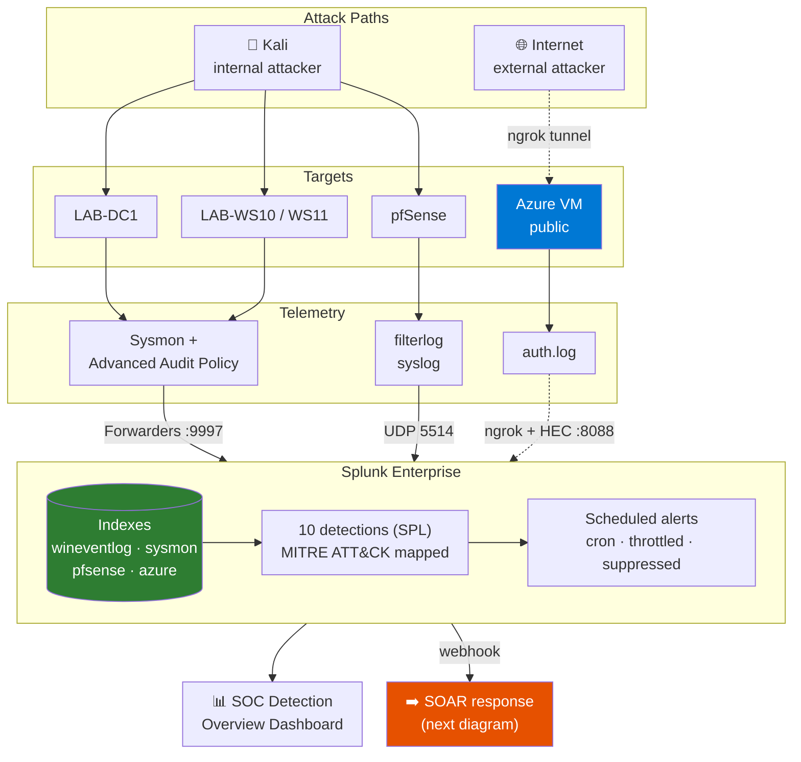
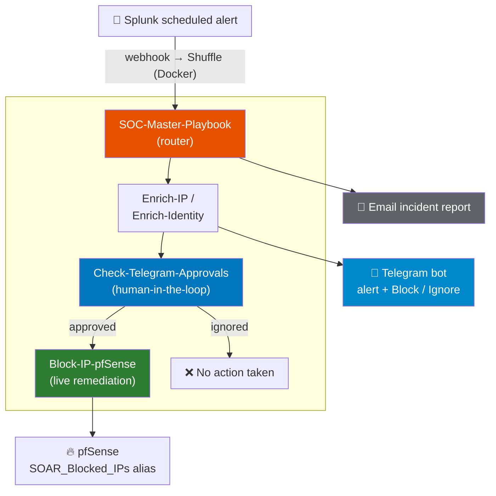

# Architecture

This lab runs entirely on a single physical workstation (16 GB RAM) using VMware Workstation, hosting an isolated enterprise network, a SIEM, a self-hosted SOAR platform, and — via a secure tunnel — a public cloud asset. This document ties together the design decisions made across every other section of this repository into one coherent picture: what was built, why it's shaped this way, and what constraints actually drove the architecture.

## Full Data Flow — From Attack to Automated Response

The end-to-end flow is shown in two stages: how an attack becomes an alert, and how an alert becomes a response.

### 1. Detection pipeline — attack to alert

### 2. Response pipeline — alert to action

## Layer-by-Layer Design Summary

| Layer | What | Why it's shaped this way | Detail |
|---|---|---|---|
| **Infrastructure** | Three VMware switches behind pfSense, a real AD forest (`soclab.internal`), Sysmon with Advanced Audit Policy deployed through one GPO, and Splunk Enterprise with Universal Forwarders and HEC | Attacks must cross a real, logged firewall; identity detections need genuine AD structure; and default Windows logging lacks the command lines and PowerShell content every detection depends on | [`infrastructure-setup/`](../infrastructure-setup) |
| **Detection engineering** | Ten SPL detections, every one outputting a shared field schema (`alert_type`, `severity`, `recommended_actions`, ...) | A standardized schema is what makes a single SOAR router (rather than ten bespoke integrations) possible at all | [`detections/`](../detections) |
| **Threat hunting** | Four manual hunts, including one that uncovered and triaged an unrelated data-integrity issue | Alerts only catch what someone thought to write a rule for; hunting is the deliberate search for what wasn't | [`threat-hunting/`](../threat-hunting) |
| **Hybrid cloud** | An Azure VM reached only via an outbound-initiated, HTTPS-encrypted tunnel (ngrok) to a HEC endpoint — never the reverse | The lab has no public IP; rather than exposing Splunk directly or abandoning the cloud component, the constraint was solved with the least-privilege connectivity option available | [`cloud-integration/`](../cloud-integration) |
| **SOAR** | Self-hosted Shuffle (Docker), one router playbook with ten enrichment branches, human-approval gate before any firewall change | Mirrors how production SOAR is actually structured: one ingestion contract, branching logic per alert type, and a hard approval gate on any state-changing action | [`soar-automation/`](../soar-automation) |
| **Visibility** | A dashboard combining alert metrics *and* log-source health (`Online`/`Silent` per host) | Alert counts alone can't distinguish "no attacks" from "the forwarder died" — both produce zero alerts | [`dashboards/`](../dashboards) |

## Key Architectural Decisions (and the Trade-offs Behind Them)

**Why one GPO instead of per-machine configuration.** A single `SOC-Audit-Policy` GPO, linked to both the endpoint OU and the Domain Controllers OU, guarantees every current and future domain member inherits identical telemetry settings — avoiding the classic home-lab failure mode of one endpoint quietly missing half its audit policy because it was configured by hand and the step was forgotten.

**Why a standardized alert schema, decided before writing the first detection.** Every detection could have returned whatever fields made sense for that specific attack. Instead, all ten were designed from the start to emit the same core field set (`alert_type`, `host`, `target_identity`, `source_ip`, `severity`, `recommended_actions`). This single decision is what later made a *router-based* SOAR design possible instead of ten disconnected automations — an architectural choice made upstream of the automation layer, not bolted on afterward.

**Why a human-approval gate exists at all.** The SOAR layer could fully automate IP blocking end-to-end. It deliberately doesn't: enrichment and notification are automated, but a firewall change always waits for an analyst's tap in Telegram. This reflects a real production principle — automate investigation and triage freely, gate anything that changes production state behind a human decision.

**Why resource constraints are documented, not hidden.** This lab runs on a single 16 GB host running VMware, Splunk, and a 5-container Docker-based SOAR stack simultaneously. Rather than presenting an idealized "it just worked" narrative, the real capacity-planning incidents — a Shuffle deployment that briefly starved Splunk of memory, a corrupted Sysmon bucket traced back to an abrupt shutdown during disk pressure — are documented with their investigation and resolution, because diagnosing and reasoning through resource constraints under pressure is itself a core SOC/infrastructure skill, not a failure to hide.

## Physical/Virtual Host Inventory

| Host | Role | OS |
|---|---|---|
| pfSense | Firewall / router, 3 interfaces | FreeBSD (pfSense CE 2.9.0) |
| LAB-DC1 | Domain Controller, DNS | Windows Server 2022 |
| LAB-WS10 | Primary endpoint (attack target) | Windows 10 Education |
| LAB-WS11 | Secondary endpoint | Windows 11 Enterprise (Evaluation) |
| LAB-SPLUNK1 | SIEM + SOAR host | Ubuntu Server 22.04 LTS |
| LAB-KALI | Attacker machine | Kali Linux |
| soc-cloud-vm | Public-facing hybrid monitoring target | Ubuntu Server 24.04 LTS (Azure) |

All seven hosts are documented in detail, with their exact IP assignments and validation screenshots, across [`infrastructure-setup/`](../infrastructure-setup) and [`cloud-integration/`](../cloud-integration).
