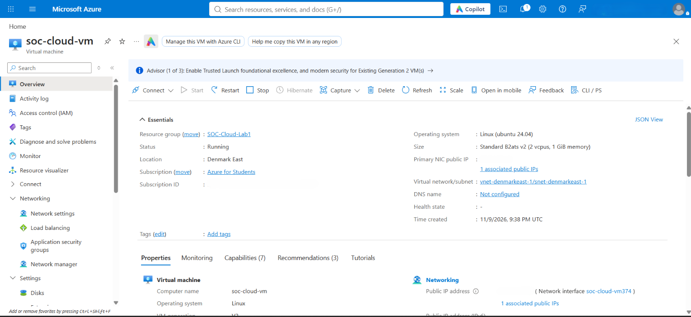
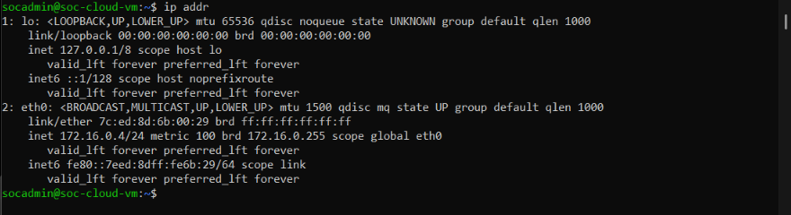

# 01 — Azure VM Deployment

## Choosing the Right Subscription Type

Microsoft offers several ways onto Azure, and they are not interchangeable from a safety standpoint. The standard **Azure Free Account** ("pay-as-you-go pricing") requires a real credit card up front and, once any trial credit or period expires, transitions to active billing on further usage — the exact outcome this lab wanted to avoid entirely for a learning project.

**Azure for Students** was used instead: a program available to holders of a verified university email address that grants **$100 of credit over 365 days with no credit card required at signup**. This is a materially different risk profile — there is no payment method on file for Azure to charge even if the credit were somehow exceeded.

> ⚠️ **A near-miss worth documenting:** during signup, the first link followed led to the standard "pay-as-you-go" flow (identifiable by its explicit "Create an Azure account with pay-as-you-go pricing" heading and a credit-card entry form) before being caught and abandoned. Microsoft's own documentation warns that activating the standard free trial on an email address first **permanently disqualifies that address from the Student offer afterward** — so verifying the signup URL and page heading *before* entering any information was a necessary, deliberate check, not a formality.

## Cost Safety Net

Before deploying anything, a **budget alert** was configured in Azure Cost Management:

| Setting | Value |
|---|---|
| Budget amount | $80 (a deliberate $20 buffer under the $100 credit) |
| Reset period | Monthly |
| Alert thresholds | 50%, 80%, 100% |
| Notification | Email |

This was treated as a prerequisite, not an afterthought — the budget was created *before* the first VM existed, on the principle that a safety control configured after the fact protects nothing retroactively.

## VM Deployment — Real Troubleshooting, Not a Clean Path

The first deployment attempt failed region validation entirely:

```
RequestDisallowedByAzure: ... is not an allowed region for this subscription type (West Europe)
```

Student subscriptions are restricted to a specific, smaller set of regions than a standard pay-as-you-go subscription — this isn't documented clearly up front, and surfaces only as a validation error at deployment time. Switching to East US cleared the region error but hit a second wall:

```
... Standard_B2ats_v2 is NotAvailableForSubscription in region eastus
```

The VM *size* was also subject to regional/subscription-type restrictions independently of the region check that had just been fixed. Rather than guessing further, the subscription's actual allowed-region policy was queried directly, returning:

```
germanywestcentral, francecentral, italynorth, uaenorth, denmarkeast
```

**Denmark East** combined with the **Standard_B2ats_v2** size (2 vCPUs, ARM-based, cost-efficient) succeeded.

| Final Configuration | Value |
|---|---|
| Name | `soc-cloud-vm` |
| Resource Group | `SOC-Cloud-Lab1` |
| Region | Denmark East |
| Image | Ubuntu Server 24.04 LTS |
| Size | Standard_B2ats_v2 |
| Public IP | *(dynamic, assigned by Azure)* |
| Authentication | Password-based (lab convenience; SSH key auth is the production-recommended alternative) |



*The deployed VM in the Azure Portal — Denmark East, Standard_B2ats_v2, Azure for Students subscription, with a single public IP attached.*



*The VM's private-network side (`172.16.0.4/24`) — distinct from the public IP used for SSH and attack traffic, and from the lab's own internal `192.168.10.0/24` range, confirming these are two genuinely separate networks connected only by the tunnel described in [`02-hybrid-log-forwarding.md`](./02-hybrid-log-forwarding.md).*

## Network Security Group Hardening

By default, a newly-created Azure VM with SSH enabled accepts connections from **any** source IP (`Source: Any`) on port 22 — acceptable for a five-minute test, not for a VM left running. The NSG rule was tightened immediately after confirming initial connectivity:

| Priority | Name | Port | Source | Action |
|---|---|---|---|---|
| 300 | SSH | 22/TCP | *(a single source IP — the analyst's own)*, not `Any` | Allow |
| 65000 | AllowVnetInBound | Any | VirtualNetwork | Allow *(default)* |
| 65001 | AllowAzureLoadBalancerInBound | Any | AzureLoadBalancer | Allow *(default)* |
| 65500 | DenyAllInBound | Any | Any | Deny *(default)* |

This means the VM is **not** a general-purpose honeypot open to arbitrary internet scanning — it is reachable for administration from one known location only, while still being a genuine internet-routable host for the purpose of the hybrid-monitoring demonstration. The attack traffic this VM's detection is built around (see [SSH Brute Force Detected](../detections/05-ssh-brute-force-linux.md)) is deliberately originated from the lab's own Kali machine against the VM's public IP, not from unsolicited internet background noise — a controlled test, not an accidental exposure.

## Validation

```bash
ssh socadmin@<AZURE_PUBLIC_IP>
```

confirmed connectivity, and

```bash
cat /var/log/auth.log | tail -20
```

confirmed the system was logging authentication attempts as expected — the prerequisite for the log-forwarding work in [`02-hybrid-log-forwarding.md`](./02-hybrid-log-forwarding.md).

## Lessons Learned

- **Student/restricted subscriptions have non-obvious regional and SKU limits** that only surface as deployment-time errors, not as up-front documentation — querying the subscription's actual policy directly resolved it faster than repeated trial-and-error guessing.
- **Default NSG rules favor "it works" over "it's safe."** Any cloud resource with a public IP should have its inbound rules reviewed and tightened immediately after the first successful connectivity test, not left at their permissive defaults.
