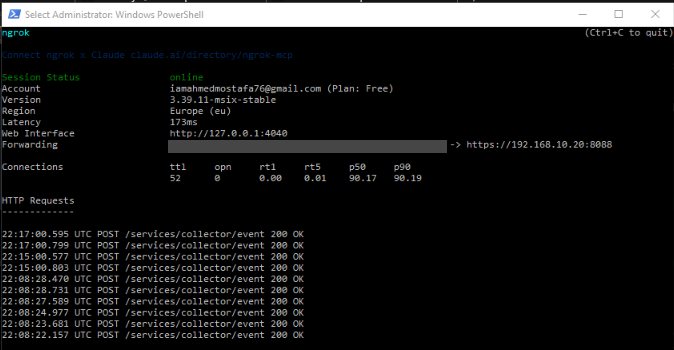

# 02 — Hybrid Log Forwarding: Azure VM → Local Splunk

## The Problem

The Azure VM has a public IP and can reach the internet freely. The lab's Splunk instance (`192.168.10.20`) sits behind pfSense on a private network with no port forwarding configured on the host's router — there is no way for an external host to initiate a connection *into* the lab. A standard Splunk Universal Forwarder, which expects to dial out to a known indexer address, has nothing reachable to dial out *to* from the Azure side, and nothing the Azure side can be reached *at* from the lab side either, since neither direction has a public listener.

## The Solution: A Secure Outbound Tunnel

Rather than modifying home router configuration (not available in this setup) or exposing Splunk directly to the internet (a meaningfully worse security posture than the alternative), **ngrok** was used to create an outbound-initiated, encrypted tunnel from the local network to the public internet, exposing only Splunk's HTTP Event Collector endpoint — not the full Splunk web interface — through it.

```
Azure VM  --(HTTPS, auth.log events)-->  ngrok public URL  --(tunnel)-->  Local machine  -->  Splunk HEC :8088
```

### Why HEC, specifically

Splunk's **HTTP Event Collector** accepts events over a simple authenticated HTTPS POST request — a protocol any Linux host (or literally any HTTP client) can speak without installing the full Universal Forwarder package, and one that works cleanly through an HTTP(S) tunnel in a way that the Splunk-to-Forwarder binary protocol (port 9997) does not.

### HEC Configuration

| Setting | Value |
|---|---|
| Port | 8088 (HTTPS) |
| Token | Dedicated token, name `azure-vm-token` |
| Target index | `azure` |

### ngrok Tunnel

```bash
ngrok http https://192.168.10.20:8088
```

Forwarding a public ngrok URL to the **HTTPS** scheme (not plain HTTP) was not optional — the first attempt, forwarding to `http://192.168.10.20:8088` instead, failed with `ERR_NGROK_3004 — invalid or incomplete HTTP response`, because Splunk's HEC listener expects TLS and rejected the plaintext connection ngrok was attempting on its behalf. Specifying the `https://` scheme explicitly in the `ngrok http` command resolved it.

This produces a public URL (e.g. `https://<random-subdomain>.ngrok-free.dev`) that proxies directly to the local Splunk HEC endpoint.



*The live tunnel session — note `Forwarding` targets `https://192.168.10.20:8088` (not plain `http`), and the `HTTP Requests` log shows a stream of successful `200 OK` POSTs to `/services/collector/event` as the Azure VM's forwarder delivers events in real time.*

Validated end-to-end with a manual request from an entirely separate machine on a different network before trusting it with real VM traffic:

```powershell
Invoke-RestMethod -Uri "https://<ngrok-subdomain>.ngrok-free.dev/services/collector/event" `
  -Method Post -Headers @{ "Authorization" = "Splunk <token>" } `
  -Body (@{ event = "external connectivity test" } | ConvertTo-Json)
```

## Forwarding `auth.log` from the Azure VM

Rather than installing a heavier log-shipping agent for a single log file, a minimal, purpose-built forwarder was written as a shell script and run as a persistent `systemd` service — a deliberate choice to survive VM reboots without manual intervention.

### Credentials file (`/etc/splunk-hec.env`, mode `600`)
```bash
HEC_URL="https://<ngrok-subdomain>.ngrok-free.dev/services/collector/event"
HEC_TOKEN="<token>"
```

### Forwarder script (`/usr/local/bin/hec-forwarder.sh`)
```bash
#!/bin/bash
source /etc/splunk-hec.env
tail -n0 -F /var/log/auth.log | while read -r line; do
  payload=$(jq -n --arg event "$line" --arg sourcetype "linux_secure" \
    '{event: $event, sourcetype: $sourcetype}')
  curl -s -o /dev/null -X POST "$HEC_URL" \
    -H "Authorization: Splunk $HEC_TOKEN" \
    -d "$payload"
done
```

- **`tail -n0 -F`** streams only new lines appended after the service starts (not the entire log history on every restart), and `-F` (rather than `-f`) correctly follows the file even if logrotate replaces it.
- **`jq`** safely JSON-encodes each raw log line as the `event` field, avoiding manual string-escaping bugs with quotes or special characters that real `auth.log` lines frequently contain.
- **`sourcetype: linux_secure`** is set explicitly in the payload itself rather than relying on HEC's default source typing, so the [SSH Brute Force detection](../detections/05-ssh-brute-force-linux.md) can reliably filter on it.

### systemd unit (`hec-forwarder.service`)
```ini
[Unit]
Description=Forward auth.log to Splunk HEC
After=network.target

[Service]
ExecStart=/bin/bash /usr/local/bin/hec-forwarder.sh
Restart=always
User=root

[Install]
WantedBy=multi-user.target
```

```bash
sudo systemctl daemon-reload
sudo systemctl enable --now hec-forwarder
sudo systemctl status hec-forwarder
```

`Restart=always` ensures the forwarder resumes automatically if it ever crashes (e.g., a transient network blip on the tunnel) rather than silently going dark and leaving a gap in telemetry until someone notices manually.

## End-to-End Validation

```bash
ssh wronguser@<AZURE_PUBLIC_IP>   # generates a real auth.log failure
```

confirmed in Splunk within seconds:

```spl
index=azure sourcetype=linux_secure | head 5
```

returning the forwarded `auth.log` line with `target_user` and `src_ip` correctly extractable — the exact fields the SSH Brute Force detection depends on.

## Summary of the Full Chain

```
Kali attacker (SSH attempt)
  → Azure VM auth.log
  → hec-forwarder.sh (systemd, tail -F + jq + curl)
  → ngrok secure tunnel (HTTPS)
  → Splunk HTTP Event Collector (:8088)
  → index=azure
  → SSH Brute Force detection (scheduled alert)
  → Shuffle SOAR webhook
```

Every link in this chain was tested independently before being trusted together — the HEC endpoint with a manual local event, the tunnel with a manual external event, and only then the live VM traffic — rather than wiring the whole pipeline at once and hoping it worked end-to-end on the first try.
