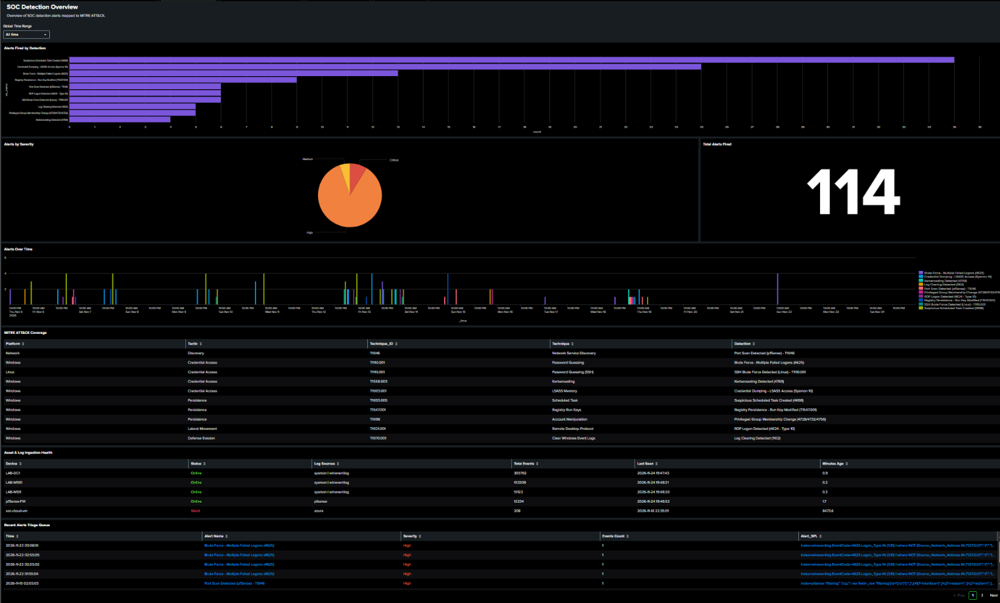
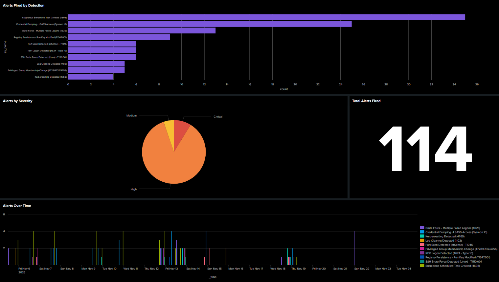
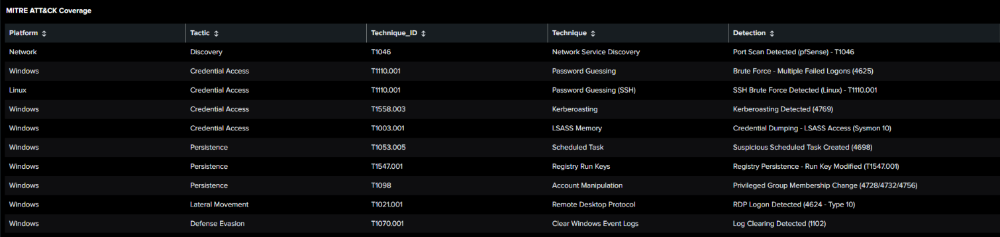
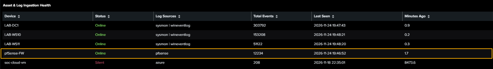
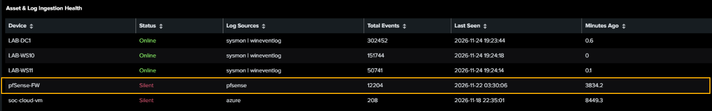
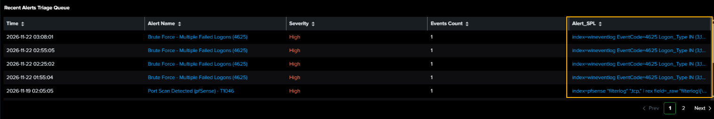

# SOC Detection Overview Dashboard

A single-pane view that answers the questions a SOC analyst actually asks at the start of a shift: *What's firing? How bad is it? Which assets are even reporting in right now? What do I need to triage first?*

*The full dashboard on **All time**: alert volume and severity at the top, MITRE ATT&CK coverage and ingestion health in the middle, and the triage queue at the bottom.*

## What Each Panel Answers

Every panel exists to answer one operational question — the dashboard is deliberately not decorative.

| Panel | Question it answers |
|---|---|
| Alerts Fired by Detection | What's generating the most noise or signal? |
| Alerts by Severity | How urgent is the overall current picture? |
| Total Alerts Fired | What's our baseline volume? |
| Alerts Over Time | Are there patterns or bursts worth investigating? |
| MITRE ATT&CK Coverage | What attack techniques can we actually detect? |
| Asset & Log Ingestion Health | Can we trust that "no alerts" means "no attacks," or is a data source just silent? |
| Recent Alerts Triage Queue | What do I work on right now, and how do I start? |

A single **Global Time Range** selector scopes the alert-history panels, so narrowing the window to "Last 24 hours" during an incident is one change rather than several. The Asset & Log Ingestion Health panel is deliberately exempt from it — see below.

## Alert Volume & Severity

**Alerts Fired by Detection.** A horizontal bar chart ranking all ten detections by trigger count. **Suspicious Scheduled Task Created** (35) and **Credential Dumping — LSASS Access** (25) lead by a wide margin. Both are genuinely higher-frequency techniques in this lab's testing history (see [`detections/10-scheduled-task.md`](../detections/10-scheduled-task.md) and [`detections/09-credential-dumping-lsass.md`](../detections/09-credential-dumping-lsass.md)), not a sign of noisy detection logic needing further tuning — these two specifically were re-validated multiple times during development.

**Alerts by Severity.** The full alert history broken down by severity. Severity is computed per alert from each detection's own thresholds — for example ≥20 failed logons or ≥100 scanned ports for Critical — with Log Clearing always Critical and Privileged Group Change Critical for Domain / Enterprise / Schema Admins (see the per-detection logic in [`detections/README.md`](../detections/README.md)). Most lab activity landed on the lower tiers, which is why High dominates and Critical is a small slice.

**Total Alerts Fired.** A single large counter — **114** at the time of writing — for an at-a-glance sense of overall alert volume across the lab's full operating history.

**Alerts Over Time.** Alert volume per day, color-coded by detection (each of the ten has a consistent color). This is where *patterns* become visible that a raw count can't show — a day with a concentrated burst of Scheduled Task alerts (olive bars), for example, corresponds directly to the periods when that detection's test attacks were being validated.

## MITRE ATT&CK Coverage

A live table mapping every detection to its Platform (Windows / Linux / Network), MITRE Tactic, Technique ID, and Technique name — effectively a running coverage matrix answering "which parts of the attack lifecycle do we actually have visibility into?" without a separate, manually maintained spreadsheet. Because it is built from the same `mitre_technique` field every detection already outputs (see [`detections/README.md`](../detections/README.md#a-standardized-alert-schema)), adding an eleventh detection adds a row here with zero additional dashboard work.

## Asset & Log Ingestion Health

A live heartbeat table showing, for every host expected to be forwarding logs, its current **Status** (`Online` / `Silent`), the log sources it forwards, total event count, and — critically — how long ago it was last seen.

**How status is decided**

- **Online** means the host's most recent event arrived less than 15 minutes ago. `pfSense-FW` gets a 24-hour window instead, because firewall logging is traffic-driven.
- **Silent** is everything else.
- The panel is pinned to **all time**, independent of the Global Time Range, so narrowing the dashboard's window can never hide a host that has stopped reporting.
- Hosts that forward by IP (pfSense) are resolved to a friendly name through the same lookup described in [`infrastructure-setup/01-network-and-pfsense.md`](../infrastructure-setup/01-network-and-pfsense.md), and the HEC / ngrok tunnel's own metadata is excluded so it never shows up as a "device."

**Why "Silent" matters as much as any detection.** A detection can only fire if its log source is actually reporting. A forwarder that silently dies — service crash, network change, a powered-off VM — produces *zero alerts*, which looks identical to *zero attacks* unless something independently watches the data pipeline itself. This panel exists to surface that distinction, and it is a deliberate design principle borrowed from production SOC tooling: **detection coverage is only meaningful alongside visibility into whether the coverage itself is currently working.**

### A real catch during testing

The panel earned its place when it flagged `pfSense-FW` as **Silent**: its last event was `2026-11-22 03:30:06`, 3,834 minutes earlier, while the firewall VM was up and remote logging was still configured.

Comparing `_time` against `_indextime` on that last event showed identical timestamps, which ruled out clock skew — Splunk had genuinely stopped receiving data. The remote-logging settings were re-applied (which restarts `syslogd`) and **System Events** were added to the forwarded categories, so the firewall now emits periodic events even when no traffic matches a logged rule. Forwarding resumed and the panel returned to `Online`, as in the first screenshot above.

`soc-cloud-vm` correctly remains **Silent**: its last event is from `2026-11-18 22:35:01`, and the dashboard reports that state rather than omitting the host or implying it is fine.

## Recent Alerts Triage Queue

A paginated working queue of the most recent alerts, each row showing Time, Alert Name, Severity, Events Count, and — notably — the highlighted **Alert_SPL** field: the actual search query that generated that specific alert, displayed inline and clickable.

**Why exposing the raw SPL matters.** A triage analyst's first instinct when reviewing an alert is usually "what exactly did this look for, and could I tweak it to pivot further?" Surfacing the query itself, rather than only the formatted result, turns every row into a one-click starting point for a deeper manual investigation — eliminating the step of hunting down which saved search corresponds to a given alert name before being able to build on it.

## Design Principle

A dashboard that only shows the first four panels looks impressive but answers only "how much." The last three — ingestion health, MITRE coverage, and the triage queue — turn it into something an analyst could actually use to start a shift.
