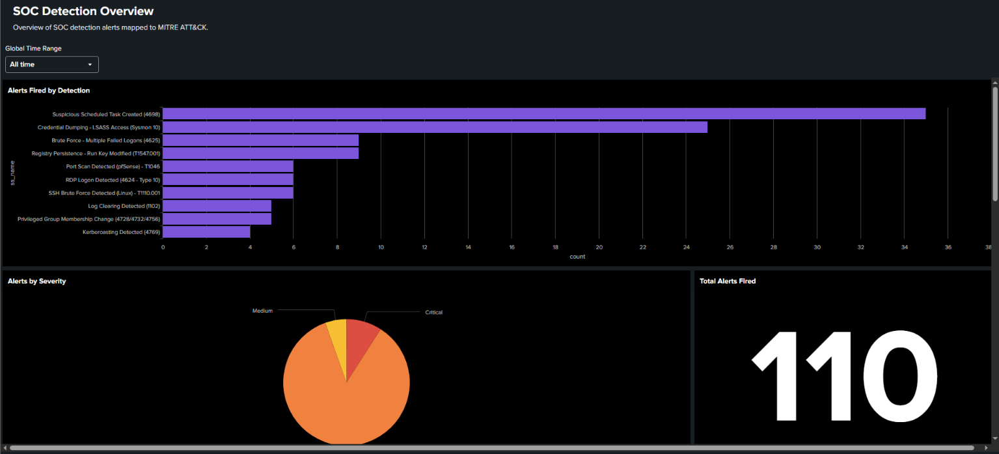
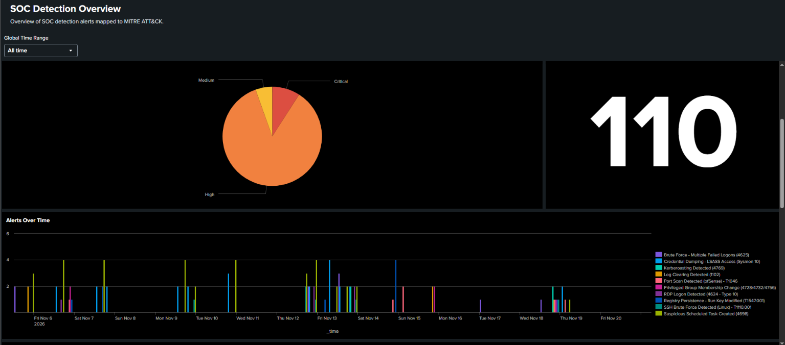
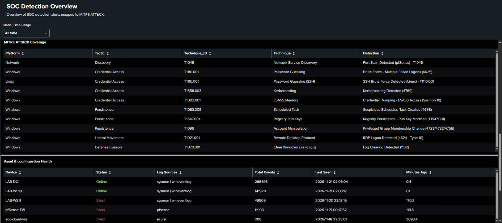
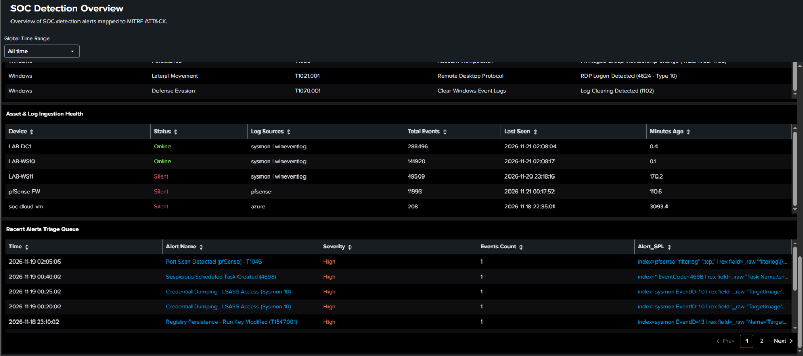

# SOC Detection Overview Dashboard

A single-pane view that answers the questions a SOC analyst actually asks at the start of a shift: *What's firing? How bad is it? Which assets are even reporting in right now? What do I need to triage first?*

The dashboard evolved well beyond an initial severity/timeline view — it now includes live asset health monitoring and an SPL-linked triage queue, documented below as the seven panels that make it up.

## Global Time Range Control

A single dashboard-wide **Global Time Range** selector (`All time` in the screenshots below, but adjustable) controls every panel simultaneously — an analyst narrowing the window to "Last 24 hours" during an active incident doesn't need to adjust seven individual panel filters one at a time.

## Panel 1 — Alerts Fired by Detection

A horizontal bar chart ranking all ten detections by trigger count. At the time of this screenshot, **Suspicious Scheduled Task Created** and **Credential Dumping — LSASS Access** are, by a wide margin, the most frequently firing detections — both genuinely higher-frequency techniques in this lab's testing history (see [`detections/10-scheduled-task.md`](../detections/10-scheduled-task.md) and [`detections/09-credential-dumping-lsass.md`](../detections/09-credential-dumping-lsass.md)), not a sign of noisy detection logic needing further tuning, since these two specifically were re-validated multiple times during development.

## Panel 2 — Alerts by Severity

A pie chart breaking down the full alert history by severity (Critical / High / Medium). The majority sitting at High/Medium rather than Critical reflects the lab's detection design: only a small number of techniques (Log Clearing, the highest Kerberoasting tier) are built to fire at Critical by design — see the per-detection severity logic in [`detections/README.md`](../detections/README.md).

## Panel 3 — Total Alerts Fired

A single large counter — **110** at the time of writing — giving an at-a-glance sense of overall alert volume across the lab's full operating history, without needing to sum up every detection individually.

## Panel 4 — Alerts Over Time

A color-coded timeline showing alert volume per day, broken down by which specific detection fired (see the legend: each of the ten detections gets a consistent color). This is where *patterns* become visible that a raw count can't show — for example, spotting a day with an unusually concentrated burst of Scheduled Task alerts (olive-colored bars) corresponds directly to the periods when that detection's test attacks (see [`detections/10-scheduled-task.md`](../detections/10-scheduled-task.md)) were actively being validated.

## Panel 5 — MITRE ATT&CK Coverage

A live table mapping every detection to its Platform (Windows / Linux / Network), MITRE Tactic, Technique ID, and Technique name — effectively a running coverage matrix answering "which parts of the attack lifecycle do we actually have visibility into?" without needing a separate, manually-maintained spreadsheet. Because this table is built from the same `mitre_technique` field every detection already outputs (see [`detections/README.md`](../detections/README.md#a-standardized-alert-schema)), adding an eleventh detection automatically adds a row here with zero additional dashboard work.

## Panel 6 — Asset & Log Ingestion Health

This is the most operationally significant addition to the dashboard: a live heartbeat table showing, for every host expected to be forwarding logs, its current **Status** (`Online` / `Silent`), which log sources it forwards, total event count, and — critically — how long ago it was last seen.

| Device | Status | Log Sources | Total Events | Minutes Ago |
|---|---|---|---|---|
| LAB-DC1 | 🟢 Online | sysmon, wineventlog | 288,496 | 0.4 |
| LAB-WS10 | 🟢 Online | sysmon, wineventlog | 141,920 | 0.1 |
| LAB-WS11 | 🔴 Silent | sysmon, wineventlog | 49,509 | 170.2 |
| pfSense-FW | 🔴 Silent | pfsense | 11,993 | 110.6 |
| soc-cloud-vm | 🔴 Silent | azure | 208 | 3,093.4 |

**Why "Silent" matters as much as any detection.** A detection can only fire if its underlying log source is actually reporting — a forwarder that silently dies (service crash, network change, a VM simply powered off) produces *zero alerts*, which looks identical to *zero attacks* unless something is independently watching whether the data pipeline itself is healthy. This panel is built specifically to surface that distinction: `LAB-WS11`, `pfSense-FW`, and `soc-cloud-vm` showing "Silent" here isn't a bug — it accurately reflects that those VMs are not continuously powered on in this lab (consistent with the memory-management practice described throughout [`infrastructure-setup/`](../infrastructure-setup) of only running the machines needed for the task at hand) — but the dashboard correctly reports that state rather than silently omitting those hosts or implying they're fine.

This is a deliberate design principle borrowed directly from production SOC tooling: **detection coverage is only meaningful alongside visibility into whether the coverage itself is currently working.**

## Panel 7 — Recent Alerts Triage Queue

A working queue of the most recent alerts, each row showing Time, Alert Name, Severity, Events Count, and — notably — the **Alert_SPL** field: the actual search query that generated that specific alert, displayed inline and clickable.

**Why exposing the raw SPL in the triage queue matters:** a triage analyst's first instinct when reviewing an alert is usually "what exactly did this look for, and could I tweak it to pivot further?" Surfacing the query itself, rather than only the formatted result, turns every row in this table into a one-click starting point for a deeper manual investigation — eliminating the step of hunting down which saved search corresponds to a given alert name before being able to build on it.

## Design Philosophy

This dashboard deliberately avoids being purely decorative. Every panel answers a specific operational question:

| Panel | Question it answers |
|---|---|
| Alerts by Detection | What's generating the most noise or signal? |
| Alerts by Severity | How urgent is the overall current picture? |
| Total Alerts Fired | What's our baseline volume? |
| Alerts Over Time | Are there patterns or bursts worth investigating? |
| MITRE ATT&CK Coverage | What attack techniques can we actually detect? |
| Asset & Log Ingestion Health | Can we trust that "no alerts" means "no attacks," or is a data source just silent? |
| Recent Alerts Triage Queue | What do I work on right now, and how do I start? |

A dashboard that only shows the first four panels looks impressive but answers only "how much." Adding the last three turns it into something an analyst could actually use to start a shift.
