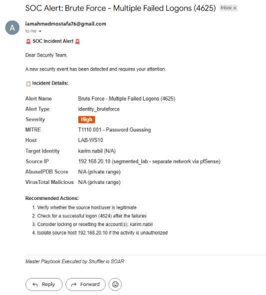

# Detection 01 — Brute Force: Multiple Failed Logons (Windows)

| | |
|---|---|
| **MITRE ATT&CK** | T1110.001 — Brute Force: Password Guessing |
| **Data Source** | Windows Security Log, Event ID 4625 |
| **Severity Logic** | ≥20 attempts → Critical, ≥10 → High, else Medium |

## Attack Simulated

From Kali (`192.168.20.10`), `Hydra` was run against RDP on `LAB-WS10` using a wordlist of common passwords against the real domain account `karim.nabil`:

```bash
hydra -l karim.nabil -P /tmp/passwords.txt rdp://192.168.10.30 -t 1 -V
```

An initial attempt targeted SMB on the domain controller instead, but failed with `[ERROR] invalid reply from target` — a known Hydra/SMB compatibility issue on modern Windows Server builds with SMB signing enforced. Switching the target to RDP on a workstation resolved it and produced clean, correlated failure events.

## Detection Logic

```spl
index=wineventlog EventCode=4625 Logon_Type IN (3,10)
| where NOT (Source_Network_Address IN ("127.0.0.1","::1","-"))
| rex "Account For Which Logon Failed:(?s).*?Account Name:\s+(?<target_account>\S+)"
| stats count as failed_attempts, min(_time) as first_seen, max(_time) as last_seen, values(target_account) as target_accounts by Source_Network_Address, host, Logon_Type
| where failed_attempts >= 5
| eval alert_name="Brute Force - Multiple Failed Logons (4625)"
| eval mitre_technique="T1110.001 - Password Guessing"
| eval severity=case(failed_attempts>=20, "Critical", failed_attempts>=10, "High", true(), "Medium")
| convert ctime(first_seen) ctime(last_seen)
| eval target_accounts_str=mvjoin(target_accounts, ", ")
| eval alert_type="identity_bruteforce", source_ip=Source_Network_Address, target_identity=target_accounts_str
| eval recommended_actions="Verify whether the source host/user is legitimate;;Check for a successful logon (4624) after the failures;;Consider locking or resetting the account(s): " . target_accounts_str . ";;Isolate source host " . Source_Network_Address . " if the activity is unauthorized"
| table alert_name, alert_type, mitre_technique, severity, host, target_identity, source_ip, failed_attempts, Logon_Type, first_seen, last_seen, recommended_actions
```

### Why it's built this way

- **`Logon_Type IN (3,10)`** restricts to network (3) and RemoteInteractive/RDP (10) logons specifically — excluding interactive console logons, which are a different threat model entirely.
- **Localhost/blank source exclusion** (`127.0.0.1`, `::1`, `-`) removes a common false-positive source: local services failing to authenticate with stale credentials, which has nothing to do with a network-based attacker.
- **Threshold of 5** was chosen empirically after the initial test attack (10 passwords, 10 failures from one source) — low enough to catch a short, focused attack, high enough to not fire on a single person mistyping their password twice.

## Validation

With the GPO from [`infrastructure-setup/03`](../infrastructure-setup/03-sysmon-and-audit-policy.md) applied, all 10 Hydra attempts appeared in Splunk within seconds, each with `Status=0xC000006D` / `Sub_Status=0xC000006A` (bad password), `Source_Network_Address=192.168.20.10`, confirming the attack crossed the pfSense firewall boundary and was logged correctly on the target endpoint.

## Alert Configuration

| Setting | Value |
|---|---|
| Schedule | Cron `*/5 * * * *` (every 5 minutes) |
| Search window | Last 5 minutes |
| Expires | 24 hours |
| Trigger condition | Number of results > 0 |
| Trigger | **Once** per run |
| Throttle | ✅ Enabled |
| **Suppress results containing field value** | `Source_Network_Address` |
| Suppress triggering for | 30 minutes |
| Trigger Actions | Add to Triggered Alerts (**Severity: High**) + **Webhook** → Shuffle `SOC-Master-Playbook` |

The throttle/suppression settings above are shared across all ten detections in this lab (same cron cadence, same "Once" trigger, same webhook action) — only the **suppression field** and the **fixed Triggered-Alert severity label** differ per detection, matched to whatever uniquely identifies a repeat occurrence of that specific attack. Here, suppressing on `Source_Network_Address` for 30 minutes means a single attacking host that keeps failing logons doesn't re-fire a fresh Splunk alert (and re-trigger the SOAR webhook) every 5 minutes for the same ongoing incident — one incident, one notification cycle, not a flood of duplicates.

**Verified live:** the alert fired automatically in `Triggered Alerts` within one scheduling cycle of re-running the attack — confirming the full pipeline (attack → log → Splunk → scheduled search → alert → webhook) works end-to-end, not just the search query in isolation.

## SOAR Output: Incident Email

The incident report emailed by the [Master Playbook](../soar-automation/01-soc-master-playbook.md) when this detection fired during testing:


