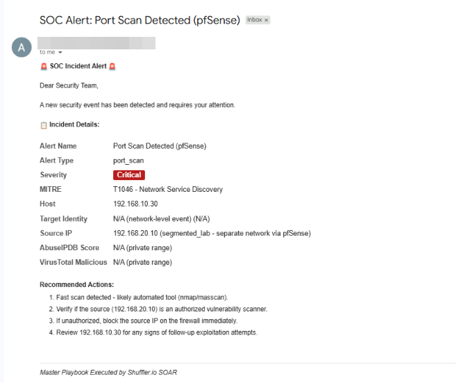
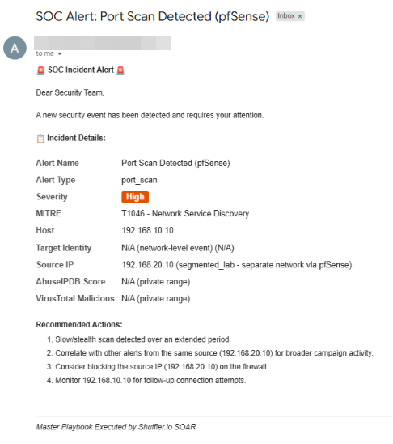

# Detection 03 — Port Scan Detected (pfSense)

| | |
|---|---|
| **MITRE ATT&CK** | T1046 — Network Service Discovery |
| **Data Source** | pfSense `filterlog` (syslog, UDP 5514) |
| **Severity Logic** | ≥100 unique ports → Critical, ≥50 → High, else Medium |

## Attack Simulated

Two distinct `nmap` scans were run from Kali against the domain controller, deliberately covering both scan speeds the detection logic is designed to catch:

**Fast scan** (wide port range, no timing restraint):
```bash
nmap -Pn -p 1-1000 192.168.10.10
```

**Slow/stealth scan** (a narrow, targeted port list with deliberate delay and a single retry, intended to stay under naive per-minute thresholds):
```bash
nmap -sS -Pn --scan-delay 5s --max-retries 1 -p 21,22,23,25,53,80,110,135,139,443,445,3389,8080 192.168.10.10
```

Because the destination ports are almost all closed, pfSense's default-deny policy on the `ATTACKER` interface logged each connection attempt as a blocked SYN packet — exactly the signal this detection looks for. Testing both scan speeds was essential: a detection tuned only to catch a fast, noisy scan would have completely missed the slow variant, which is the more realistic technique a cautious real-world attacker would actually use to evade exactly this kind of volume-based alerting.

## Detection Logic

```spl
index=pfsense "filterlog" ",tcp,"
| rex field=_raw "filterlog\[\d+\]:\s*(?:[^,]*,){4}(?<interface>[^,]+),(?<reason>[^,]+),(?<action>[^,]+),(?<direction>[^,]+),4,(?:[^,]*,){7}tcp,(?<length>\d+),(?<src_ip>[\d\.]+),(?<dst_ip>[\d\.]+),(?<src_port>\d+),(?<dst_port>\d+),(?<data_len>\d+),(?<tcp_flags>[A-Z]*),"
| where tcp_flags="S"
| bin _time span=1m as minute_bucket
| eventstats dc(dst_port) as ports_1m by minute_bucket, src_ip, dst_ip
| eventstats dc(dst_port) as ports_total, count as total_syn, min(_time) as first_seen, max(_time) as last_seen by src_ip, dst_ip
| eval scan_type=case(ports_1m>=20, "Fast Scan", ports_total>=50, "Slow/Stealth Scan")
| where isnotnull(scan_type)
| stats max(ports_1m) as max_ports_per_minute, max(ports_total) as total_unique_ports, max(total_syn) as total_attempts, values(scan_type) as scan_type, values(action) as actions, min(first_seen) as first_seen, max(last_seen) as last_seen by src_ip, dst_ip, interface
| eval severity=case(total_unique_ports>=100,"Critical", total_unique_ports>=50,"High", true(),"Medium")
| eval mitre_technique="T1046 - Network Service Discovery"
| eval alert_name="Port Scan Detected (pfSense)"
| convert ctime(first_seen) ctime(last_seen)
| eval scan_type_str=mvjoin(scan_type, ", ")
| eval actions_str=mvjoin(actions, ", ")
| eval recommended_actions=case(
    scan_type_str=="Fast Scan", "Fast scan detected - likely automated tool (nmap/masscan).;;Verify if the source (" . src_ip . ") is an authorized vulnerability scanner.;;If unauthorized, block the source IP on the firewall immediately.;;Review " . dst_ip . " for any signs of follow-up exploitation attempts.",
    true(), "Slow/stealth scan detected over an extended period.;;Correlate with other alerts from the same source (" . src_ip . ") for broader campaign activity.;;Consider blocking the source IP (" . src_ip . ") on the firewall.;;Monitor " . dst_ip . " for follow-up connection attempts.")
| eval alert_type="port_scan", source_ip=src_ip, host=dst_ip, target_identity="N/A (network-level event)"
| table alert_name, alert_type, mitre_technique, severity, host, target_identity, source_ip, scan_type_str, max_ports_per_minute, total_unique_ports, total_attempts, interface, first_seen, last_seen, recommended_actions
```

### Why it's built this way

- **Raw `rex` field extraction instead of an add-on.** pfSense's `filterlog` format is a dense, comma-separated structure with no app providing field extraction out of the box in this lab, so the fields (interface, action, direction, protocol, IPs, ports, TCP flags) are parsed directly from `_raw` using a positional regex (`(?:[^,]*,){4}` skips a fixed number of leading fields before naming the ones that matter).
- **`tcp_flags="S"`** isolates SYN packets specifically — the first packet of a TCP handshake, and what a port scanner sends regardless of whether the target responds. This avoids double-counting a single scan attempt across multiple packet types.
- **Two distinct time windows, computed with `eventstats` rather than `stats`:** a 1-minute bucket (`ports_1m`) catches a *fast* scan (many ports hit almost simultaneously), while a total-session count (`ports_total`) catches a *slow/stealth* scan spread out to evade a tight time-window threshold. Using `eventstats` (which annotates every event rather than collapsing them) allows both window calculations to coexist in the same pipeline before the final `stats` aggregation.

## Validation

Running the `nmap -p 1-1000` scan produced several hundred blocked SYN events in `index=pfsense` within seconds, confirming both that the firewall's attacker-interface logging rule (see [`infrastructure-setup/01`](../infrastructure-setup/01-network-and-pfsense.md)) was capturing the expected volume, and that the regex correctly extracted `src_ip=192.168.20.10` for every event.

## Alert Configuration

| Setting | Value |
|---|---|
| Schedule | Cron `*/5 * * * *` (every 5 minutes) |
| Search window | **Last 15 minutes** (wider than the other nine detections, to give the slow-scan logic in the SPL a long enough lookback to accumulate its total-port count) |
| Expires | 24 hours |
| Trigger condition | Number of results > 0 |
| Trigger | **Once** per run |
| Throttle | ✅ Enabled |
| **Suppress results containing field value** | `source_ip` |
| Suppress triggering for | 10 minutes |
| Trigger Actions | Add to Triggered Alerts (**Severity: High**) + **Webhook** → Shuffle `SOC-Master-Playbook` |

This is the one detection with a different search window (15 minutes instead of the 5-minute window shared by the other nine) and a shorter suppression period (10 minutes instead of 30) — a deliberate tuning choice, not an inconsistency: a slow/stealth scan can legitimately take longer than 5 minutes to accumulate enough distinct ports to cross the detection's threshold, so the search needs the longer lookback to catch it at all, while the shorter suppression window reflects that a scan in progress is worth re-surfacing to the analyst sooner than, say, an ongoing brute-force attempt.

## Note on Platform Coverage

This is the only detection in the set built against **network/firewall telemetry** rather than a Windows or Linux host log — deliberately included to demonstrate detection engineering isn't limited to endpoint logs, and that the same analytical approach (parse → aggregate over a time window → threshold → enrich) applies regardless of the underlying data source format.

## Example Notification

The incident report generated by the SOAR Master Playbook when this detection fired:





*The two emails come from the same detection: severity is derived from the number of unique ports touched (≥100 → Critical, ≥50 → High), and the recommended actions differ between a fast scan and a slow/stealth scan.*
