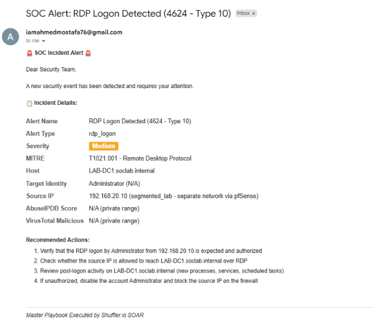

# Detection 04 — RDP Logon Detected

| | |
|---|---|
| **MITRE ATT&CK** | T1021.001 — Remote Desktop Protocol |
| **Data Source** | Windows Security Log, Event ID 4624 (Logon Type 10) |
| **Severity Logic** | ≥3 distinct source IPs or ≥10 logons → Critical; ≥2 sources or ≥5 logons → High; else Medium |

## Attack Simulated

From Kali, a full RDP session was established against the domain controller using the built-in `Administrator` account:

```bash
xfreerdp3 /v:192.168.10.10 /u:Administrator /p:'Pass@word!' /cert:ignore /log-level:INFO
```

Unlike the brute-force scenarios elsewhere in this lab, this is a **successful** authenticated logon — deliberately chosen to validate that this detection fires on legitimate-looking access from an unexpected network (the isolated attacker segment), not just on failures.

## Rationale

Unlike the other detections, this one does not look for failure — it looks for **successful** RDP logons (Logon Type 10 specifically, which Windows reserves for RemoteInteractive sessions) and flags them as worth reviewing, not necessarily malicious. In a lateral-movement scenario, the interesting signal isn't that an attacker tried to log in — it's that they *succeeded*, especially from an unexpected or multiple source IPs.

## Detection Logic

```spl
index=* EventCode=4624 Logon_Type=10
| eval Account_Name=mvindex(Account_Name, -1)
| where NOT match(Account_Name, "\$")
| stats count as rdp_logons, dc(Source_Network_Address) as unique_source_ips, values(Source_Network_Address) as source_ips, min(_time) as first_seen, max(_time) as last_seen by Account_Name, ComputerName
| eval mitre_technique="T1021.001 - Remote Desktop Protocol"
| eval alert_name="RDP Logon Detected (4624 - Type 10)"
| eval severity=case(unique_source_ips>=3 OR rdp_logons>=10, "Critical", unique_source_ips>=2 OR rdp_logons>=5, "High", true(), "Medium")
| convert ctime(first_seen) ctime(last_seen)
| eval source_ips_str=mvjoin(source_ips, ", ")
| eval alert_type="rdp_logon", source_ip=source_ips_str, target_identity=Account_Name, host=ComputerName
| eval recommended_actions=if(unique_source_ips>=2,
    "Multiple source IPs (" . source_ips_str . ") logged in as " . Account_Name . ": verify whether the account is shared or compromised;;Confirm each RDP session with the account owner;;Review post-logon activity on " . ComputerName . " (new processes, services, scheduled tasks);;Consider resetting the password for " . Account_Name . " and restricting RDP access",
    "Verify that the RDP logon by " . Account_Name . " from " . source_ips_str . " is expected and authorized;;Check whether the source IP is allowed to reach " . ComputerName . " over RDP;;Review post-logon activity on " . ComputerName . " (new processes, services, scheduled tasks);;If unauthorized, disable the account " . Account_Name . " and block the source IP on the firewall")
| table alert_name, alert_type, mitre_technique, severity, host, target_identity, source_ip, unique_source_ips, rdp_logons, first_seen, last_seen, recommended_actions
```

### Why it's built this way

- **`mvindex(Account_Name, -1)`** handles a quirk where 4624 events can return `Account_Name` as a multivalue field (one value for the computer account context, one for the user) — taking the last value consistently resolves to the actual user.
- **Machine account exclusion (`\$`)** removes `ComputerName$` service-to-service logons, which are not a person sitting down at a remote session and are not relevant here.
- **Two independent severity triggers (`unique_source_ips` OR `rdp_logons`)** — either a single account logging in from several different locations in a short window, *or* an unusually high volume of logons from one place, is treated as suspicious on its own; they don't both need to be true.
- **`recommended_actions` branches based on source-IP diversity**, giving a materially different (and more urgent) checklist when the same account appears to be logging in from multiple locations — a stronger indicator of credential sharing or compromise than a single consistent source.

## Alert Configuration

| Setting | Value |
|---|---|
| Schedule | Cron `*/5 * * * *` (every 5 minutes) |
| Search window | Last 5 minutes |
| Expires | 24 hours |
| Trigger condition | Number of results > 0 |
| Trigger | **Once** per run |
| Throttle | ✅ Enabled |
| **Suppress results containing field value** | `source_ip` |
| Suppress triggering for | 30 minutes |
| Trigger Actions | Add to Triggered Alerts (**Severity: High**) + **Webhook** → Shuffle `SOC-Master-Playbook` |

## Validation

Legitimate domain-join and administrative RDP sessions used throughout lab setup (e.g., connecting to `LAB-WS10` while configuring the Universal Forwarder) were confirmed to appear correctly in this detection at Medium severity with a single source IP — validating that the detection distinguishes routine single-source access from the higher-severity multi-source pattern, rather than treating every RDP session identically. The `xfreerdp3` session from Kali's isolated attacker subnet, by contrast, correctly fired the alert given the unexpected source network, even though the credentials used were valid.

## SOAR Output: Incident Email

The incident report emailed by the [Master Playbook](../soar-automation/01-soc-master-playbook.md) when this detection fired during testing:


