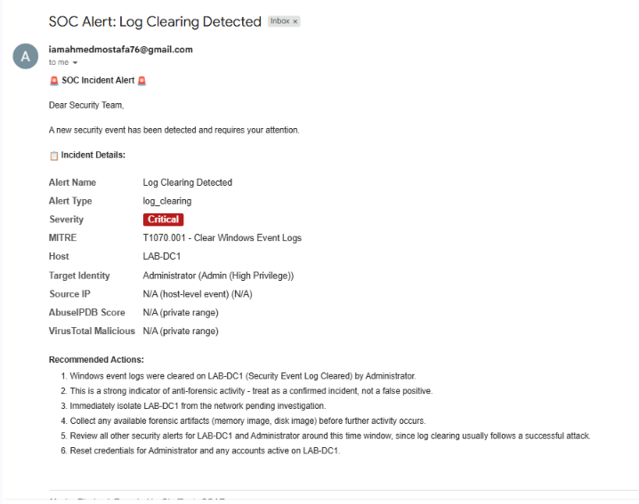

# Detection 07 — Log Clearing Detected

| | |
|---|---|
| **MITRE ATT&CK** | T1070.001 — Clear Windows Event Logs |
| **Data Source** | Windows Security/System Log, Event IDs 1102 / 104 |
| **Severity Logic** | Always Critical |

## Attack Simulated

On `LAB-DC1`, the Security event log was cleared directly using the built-in Windows event log utility — the exact command an attacker (or a careless administrator) would use to destroy evidence of prior activity:

```powershell
wevtutil cl Security
```

Clearing the Security log itself generates one final, un-erasable event (1102) recording that the clear happened and who did it — which is precisely the signal this detection depends on; the attacker cannot clear the log entry that documents the log being cleared.

## Rationale

There is no legitimate day-to-day reason for an end user or standard administrative workflow to clear the Windows Security event log. This is treated differently from every other detection in this set: it is the only one with a **fixed Critical severity** and language in its recommended actions that explicitly tells the analyst not to treat it as a possible false positive.

## Detection Logic

```spl
index=* EventCode=1102 OR EventCode=104
| eval action=case(
    EventCode=1102, "Security Event Log Cleared",
    EventCode=104, "Other Event Log Cleared"
  )
| eval Computer=coalesce(Computer, host)
| eval user=replace(user, "\$", "")
| eval mitre_technique="T1070.001 - Clear Windows Event Logs"
| eval alert_name="Log Clearing Detected"
| eval severity="Critical"
| convert ctime(_time) as event_time
| eval recommended_actions="Windows event logs were cleared on " . Computer . " (" . action . ") by " . user . ".;;This is a strong indicator of anti-forensic activity - treat as a confirmed incident, not a false positive.;;Immediately isolate " . Computer . " from the network pending investigation.;;Collect any available forensic artifacts (memory image, disk image) before further activity occurs.;;Review all other security alerts for " . Computer . " and " . user . " around this time window, since log clearing usually follows a successful attack.;;Reset credentials for " . user . " and any accounts active on " . Computer . "."
| eval alert_type="log_clearing", source_ip="N/A (host-level event)", target_identity=user, host=Computer
| table alert_name, alert_type, mitre_technique, severity, host, target_identity, source_ip, action, EventCode, event_time, recommended_actions
```

### Why it's built this way

- **Both 1102 (Security log cleared) and 104 (any other log cleared)** are covered, because an attacker wiping the Application or System log to hide installation or crash artifacts is just as deliberate a defense-evasion action as clearing the Security log itself — the technique is the same even though the event ID differs.
- **`coalesce(Computer, host)`** handles the fact that 1102/104 events are sometimes logged with the computer name in a `Computer` XML field and sometimes only derivable from Splunk's own `host` field, depending on the exact forwarder/sourcetype path the event took.
- **No volume or frequency threshold** — unlike every other detection in this set, a single occurrence is sufficient to fire. Log clearing is a binary event: it either happened or it didn't, and there is no "it happened a few times so it's probably fine" interpretation.
- **The recommended actions explicitly instruct network isolation and forensic collection before further investigation**, reflecting that log clearing is very frequently a *post-exploitation cleanup step* — by the time it's observed, the actual compromise likely already happened and evidence preservation becomes the priority.

## Alert Configuration

| Setting | Value |
|---|---|
| Schedule | Cron `*/5 * * * *` (every 5 minutes) |
| Search window | Last 5 minutes |
| Expires | 24 hours |
| Trigger condition | Number of results > 0 |
| Trigger | **Once** per run |
| Throttle | ✅ Enabled |
| **Suppress results containing field value** | `host` |
| Suppress triggering for | 30 minutes |
| Trigger Actions | Add to Triggered Alerts (**Severity: Critical**) + **Webhook** → Shuffle `SOC-Master-Playbook` |

This is the only detection in the set with a fixed **Critical** label at the Triggered-Alert level matching the fixed `severity="Critical"` computed in the SPL itself — every other detection's Triggered-Alert severity is set to a representative default (typically High) because the underlying SPL computes a *variable* severity per incident; here, both layers agree because there is no variability to represent.

## Operational Note

This detection's output feeds the SOAR Master Playbook's enrichment branch for `log_clearing`, which notifies via both email and Telegram without an automated remediation action — consistent with its design intent of forcing immediate human attention rather than an automated response, since the appropriate next step (isolation, forensic imaging) is not something to automate blindly.

## SOAR Output: Incident Email

The incident report emailed by the [Master Playbook](../soar-automation/01-soc-master-playbook.md) when this detection fired during testing:


