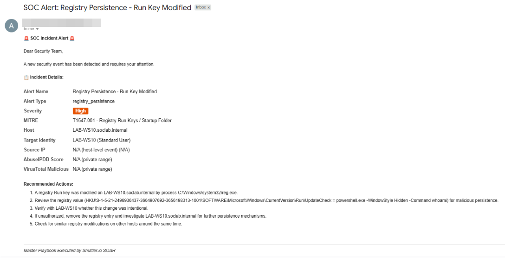

# Detection 08 — Registry Persistence: Run Key Modified

| | |
|---|---|
| **MITRE ATT&CK** | T1547.001 — Registry Run Keys / Startup Folder |
| **Data Source** | Sysmon, Event ID 13 (Registry value set) |
| **Severity Logic** | Suspicious interpreter (PowerShell/cmd/wscript/mshta/rundll32) in path or value → High, else Medium |

## Attack Simulated

On `LAB-WS10`, a Run key was added to the current user's registry hive, configured to silently launch a hidden PowerShell command on every logon:

```powershell
reg add "HKCU\Software\Microsoft\Windows\CurrentVersion\Run" /v "UpdateCheck" /t REG_SZ /d "powershell.exe -WindowStyle Hidden -Command whoami" /f
```

The value name (`UpdateCheck`) and benign-sounding command (`whoami`) were chosen deliberately to mimic how real persistence payloads are often disguised as routine update-checking entries — testing whether the detection's logic catches the technique based on structure (a hidden PowerShell invocation in a Run key) rather than requiring an obviously malicious-looking command.

## Rationale

Modifying a Run/RunOnce registry key is one of the oldest and still most common Windows persistence techniques — the malicious entry executes automatically at every logon or boot. The challenge with this detection isn't finding registry writes; it's filtering out the enormous volume of legitimate software (Windows Update, browser auto-launch entries, OneDrive) that also writes to these same keys constantly.

## Detection Logic

```spl
index=sysmon EventID=13
| rex field=_raw "Name='TargetObject'>(?<TargetObject>[^<]+)"
| rex field=_raw "Name='Details'>(?<Details>[^<]*)"
| rex field=_raw "Name='Image'>(?<Image>[^<]+)"
| rex field=_raw "Name='User'>(?<User>[^<]+)"
| rex field=_raw "Computer>(?<Computer>[^<]+)"
| where match(TargetObject, "(?i)\\\\CurrentVersion\\\\(Run|RunOnce|RunServices)\\\\|\\\\Winlogon\\\\(Shell|Userinit)$|\\\\CurrentVersion\\\\Policies\\\\Explorer\\\\Run\\\\")
| search NOT Image IN ("*\\msiexec.exe", "*\\OneDriveSetup.exe", "*\\TrustedInstaller.exe")
| search NOT (Image="*\\Microsoft\\Edge\\Application\\msedge.exe" AND TargetObject="*\\Run\\MicrosoftEdgeAutoLaunch_*")
| eval User=replace(User, "^.*\\\\", "")
| eval suspicious_path=if(match(Details, "(?i)\\\\Users\\\\|\\\\Temp\\\\|\\\\AppData\\\\|powershell|cmd\\.exe|wscript|mshta|rundll32"), "Yes", "No")
| where suspicious_path="Yes"
| stats count as modification_count, values(TargetObject) as registry_keys, values(Details) as details_list, min(_time) as first_seen, max(_time) as last_seen by Computer, User, Image
| eval mitre_technique="T1547.001 - Registry Run Keys / Startup Folder"
| eval alert_name="Registry Persistence - Run Key Modified"
| eval registry_keys_str=mvjoin(registry_keys, ", ")
| eval details_str=mvjoin(details_list, ", ")
| eval severity=if(match(Image, "(?i)powershell|cmd\\.exe|wscript|mshta|rundll32") OR match(details_str, "(?i)powershell|cmd\\.exe|wscript|mshta|rundll32"), "High", "Medium")
| convert ctime(first_seen) ctime(last_seen)
| eval recommended_actions="A registry Run key was modified on " . Computer . " by process " . Image . ".;;Review the registry value (" . registry_keys_str . " = " . details_str . ") for malicious persistence.;;Verify with " . User . " whether this change was intentional.;;If unauthorized, remove the registry entry and investigate " . Computer . " for further persistence mechanisms.;;Check for similar registry modifications on other hosts around the same time."
| eval alert_type="registry_persistence", source_ip="N/A (host-level event)", target_identity=if(User="N/A" OR User="", Computer, User), host=Computer
| table alert_name, alert_type, mitre_technique, severity, host, target_identity, source_ip, Image, registry_keys_str, details_str, modification_count, first_seen, last_seen, recommended_actions
```

### Why it's built this way

- **The `TargetObject` match covers four distinct persistence registry locations**, not just the obvious `Run` key — including `Winlogon\Shell` and `Winlogon\Userinit` (which hijack the login shell itself) and the Group Policy-managed Explorer Run key, all of which are functionally equivalent persistence vectors with different registry paths.
- **A two-stage noise filter:** first a hard exclude-list for known-legitimate installer/update processes (`msiexec.exe`, `OneDriveSetup.exe`, `TrustedInstaller.exe`) and the specific, extremely common Edge auto-launch entry; then a *positive* signal check (`suspicious_path`) requiring the registry value itself to reference a user-writable directory (`Users`, `Temp`, `AppData`) or a scripting interpreter before the event is even considered. This "exclude the known-good, then require a positive bad signal" pattern catches more real persistence attempts than either filter alone.
- **Severity escalates specifically when a scripting interpreter is involved** (PowerShell, cmd, wscript, mshta, rundll32) — a Run key pointing directly at a compiled executable is lower-confidence maliciousness than one invoking a script interpreter, which is a much stronger LOLBins-style persistence pattern.

## Alert Configuration

| Setting | Value |
|---|---|
| Schedule | Cron `*/5 * * * *` (every 5 minutes) |
| Search window | Last 5 minutes |
| Expires | 24 hours |
| Trigger condition | Number of results > 0 |
| Trigger | **Once** per run |
| Throttle | ✅ Enabled |
| **Suppress results containing field value** | `Computer` |
| Suppress triggering for | 30 minutes |
| Trigger Actions | Add to Triggered Alerts (**Severity: High**) + **Webhook** → Shuffle `SOC-Master-Playbook` |

## Relationship to Threat Hunting

This detection's exclusion logic was informed directly by the "Living off the Land" threat hunt (see [`threat-hunting/`](../threat-hunting)) — understanding which native Windows tools are *normally* seen in this telemetry stream (and which are not) came first, and the detection's noise filtering reflects that baseline.

## Example Notification

The incident report generated by the SOAR Master Playbook when this detection fired:


