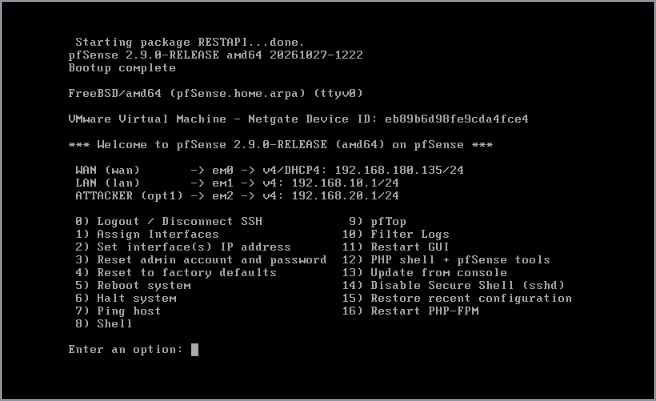
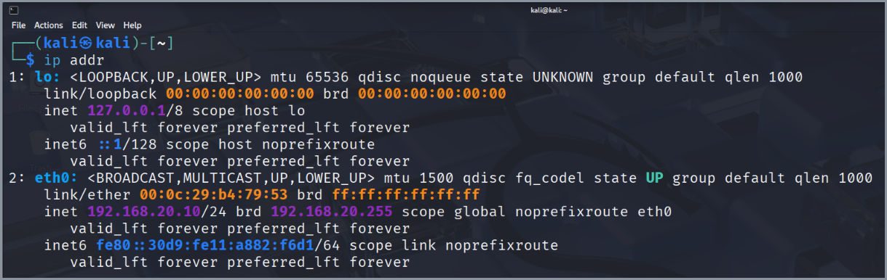
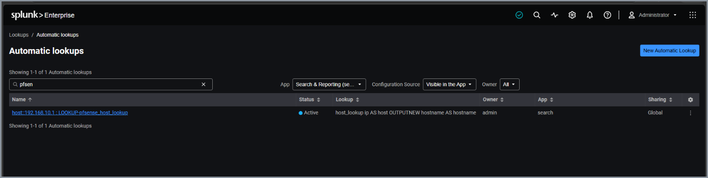
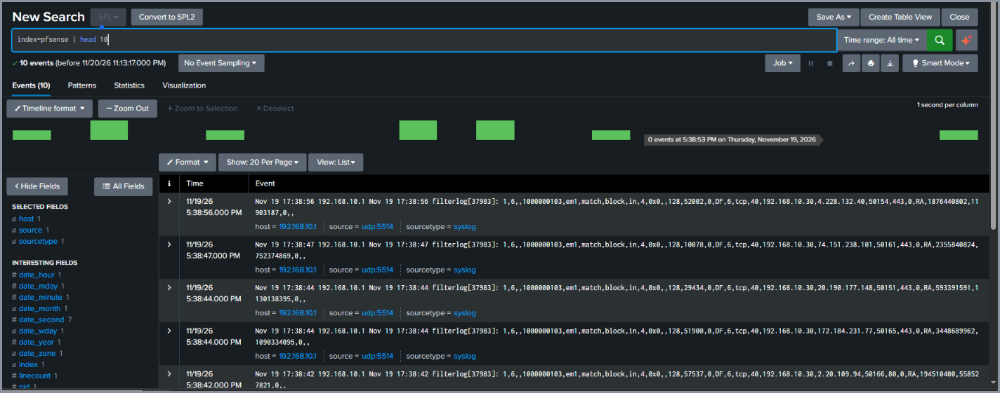
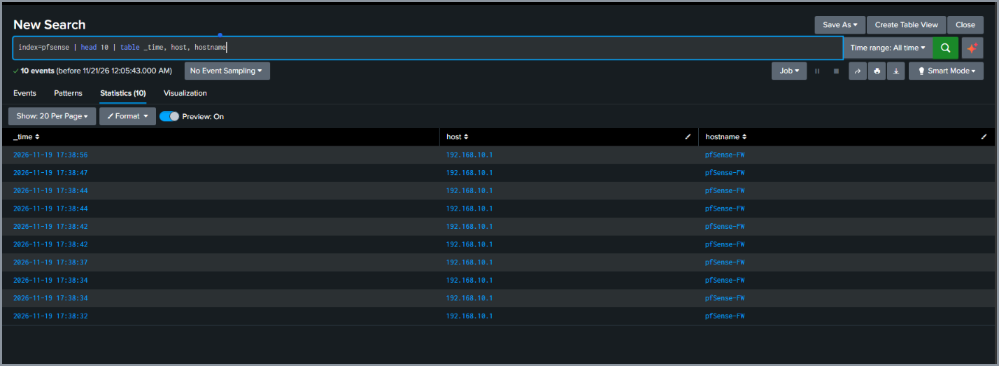

# 01 — Network Design & pfSense Firewall

## Goal

Build an isolated, enterprise-style network inside VMware Workstation with three distinct zones — WAN (internet), a corporate LAN, and a dedicated attacker segment — all mediated by a pfSense firewall, so that every attack simulated in this lab has to cross a real firewall boundary and generate real firewall logs.

## Network Topology

| Virtual Switch | Type | Subnet | Purpose |
|---|---|---|---|
| VMnet8 | NAT | 192.168.180.0/24 | WAN — internet access via the host |
| VMnet5 | Host-only (custom) | 192.168.10.0/24 | Corporate LAN — domain controller, endpoints, Splunk |
| VMnet6 | Host-only (custom) | 192.168.20.0/24 | Attacker network — isolated, only reaches the LAN through pfSense rules |

Both internal switches have **DHCP disabled** and the **host virtual adapter unchecked**, so the host machine itself has no direct route into either internal network — all internal addressing is static and managed deliberately.

## pfSense Interface Assignment

| Interface | NIC | Address | Role |
|---|---|---|---|
| WAN | em0 | DHCP (via NAT) | Internet egress |
| LAN | em1 | 192.168.10.1/24 | Corporate network gateway |
| OPT1 (renamed `ATTACKER`) | em2 | 192.168.20.1/24 | Attacker network gateway |

## Key Design Decisions

- **DHCP disabled everywhere internally.** Every host in the lab has a static IP, mirroring how enterprise infrastructure (servers, domain controllers) is typically addressed, and making log correlation unambiguous.
- **Default-deny on the attacker interface.** pfSense denies all traffic from `ATTACKER` by default. An explicit **Pass** rule was added for the attacker subnet with **logging enabled**, so every connection attempt from Kali — successful or not — generates a firewall log entry sent to Splunk.
- **HTTPS admin access kept enabled** (not reverted to HTTP) when prompted during setup, for a more realistic security posture.

## Firewall Rule (ATTACKER interface)

| Field | Value |
|---|---|
| Action | Pass |
| Interface | ATTACKER |
| Protocol | Any |
| Source | ATTACKER subnet |
| Destination | Any |
| Log | ✅ Enabled |
| Description | `Lab: attacker net to all (logged)` |

## Remote Syslog to Splunk

pfSense forwards its logs to Splunk over UDP:

- **Status → System Logs → Settings → Remote Logging**
- Remote log server: `192.168.10.20:5514`
- Content: **Firewall Events** (the detection source) and **System Events**, which give the [ingestion-health heartbeat](../dashboards/README.md#asset--log-ingestion-health) a signal even when no traffic matches a logged rule. Other categories are left off to avoid flooding the index with unrelated noise.

On the Splunk side, a UDP input was created on port `5514`, sourcetype `syslog`, indexed into a dedicated `pfsense` index.

## Validation



*WAN, LAN, and the renamed `ATTACKER` (OPT1) interface, each with their final assigned addresses, as shown on the pfSense console after setup.*



*`LAB-KALI`'s `eth0` correctly placed on the isolated attacker subnet (`192.168.20.10/24`) — the source address seen in every detection in this lab that was validated against a Kali-originated attack.*

With pfSense, the domain controller, and Splunk running, traffic generated from Kali (`ping`, `nmap`) against the LAN was confirmed to appear in Splunk within ~1 minute:

```spl
index=pfsense | head 10
```

Raw `filterlog` events showed source/destination IPs, ports, protocol, and pass/block action — exactly the fields later used to build the **Port Scan Detection (T1046)** detection.

## Friendly Hostname Resolution via Automatic Lookup

pfSense's `filterlog` format has no hostname field — only the firewall's own IP (`192.168.10.1`) — which meant every pfSense event in Splunk displayed a raw IP in the `host` field instead of a readable name, unlike every Windows event which shows an actual hostname like `LAB-DC1`.

Rather than appending a manual `| lookup` command to every pfSense search (easy to forget, and inconsistent across dashboards and detections), a **Splunk Automatic Lookup** was configured globally:

- **Lookup table:** `host_lookup.csv` (`ip,hostname` → `192.168.10.1,pfSense-FW`)
- **Automatic lookup definition:** `host::192.168.10.1 : LOOKUP-pfsense_host_lookup`, applied whenever `host` matches, outputting a new `hostname` field
- **Scope:** Global, so it applies transparently to *every* search, report, dashboard panel, and detection across the entire Splunk instance — including the [Port Scan Detection](../detections/03-port-scan-pfsense.md) and the SOC Detection Overview dashboard — without any of them needing to reference the lookup explicitly.

This is a small but deliberate platform-level decision: solving the "ugly IP in the UI" problem once, centrally, rather than patching around it in ten different SPL queries.



*The automatic lookup definition in Splunk — applies globally whenever `host` matches `192.168.10.1`.*

**Before the lookup** — raw `filterlog` events show only the firewall's IP as the host:



**After the lookup** — the same events, with a resolved `hostname` field added automatically, no query changes required:



## Lessons Learned

- An early install of pfSense (via an older RC installer build) repeatedly crashed with a `Segmentation fault` during the final package install step, regardless of memory allocated. Switching to the current Netgate installer release resolved it — a reminder to always validate the installer version before assuming a hardware/resource issue.
