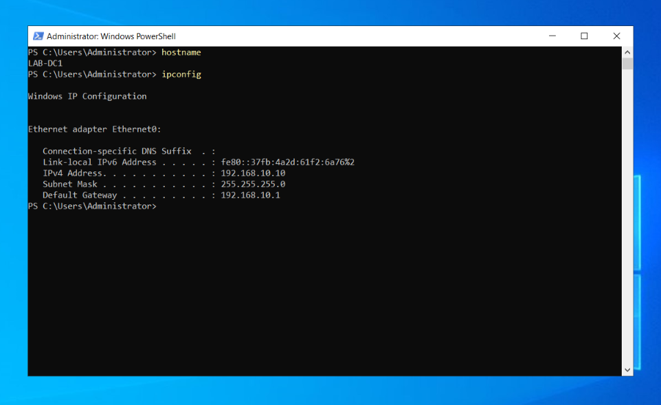
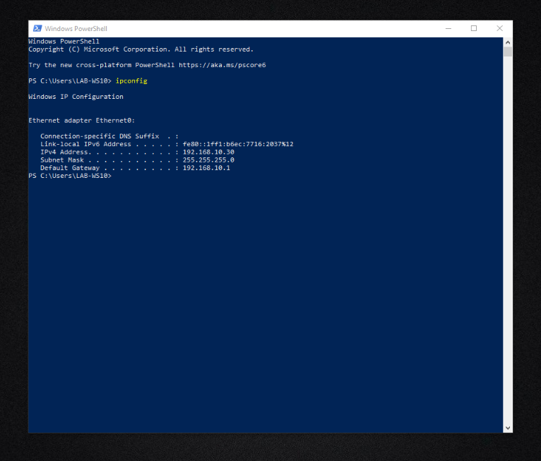
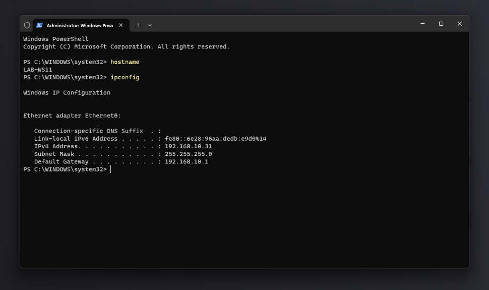
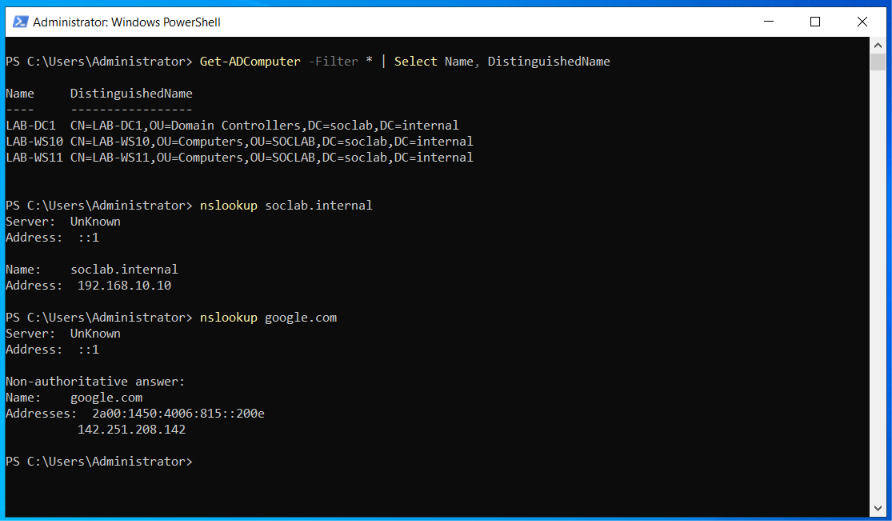

# 02 — Active Directory Domain

## Goal

Stand up a small but structurally realistic Active Directory environment — the way a small business or branch office would actually be organized — rather than a flat, single-OU test domain. This matters because several detections in this lab (privileged group changes, Kerberoasting against service accounts, lateral movement between endpoints) only make sense against a domain with real organizational structure.

## Domain Details

| Attribute | Value |
|---|---|
| Domain (FQDN) | `soclab.internal` |
| NetBIOS name | `SOCLAB` |
| Domain Controller | `LAB-DC1` (192.168.10.10) |
| Forest/Domain functional level | Windows Server 2022 |

`.internal` was chosen over `.local` deliberately to avoid common mDNS/multicast-DNS conflicts, and to present as a more standard internal-namespace convention.

## Organizational Unit Structure

```
soclab.internal
└── OU=SOCLAB
    ├── OU=Users
    ├── OU=Computers
    ├── OU=Servers
    ├── OU=Admins
    ├── OU=ServiceAccounts
    └── OU=Groups
```

(The built-in `Domain Controllers` OU was left at its default location, as is standard practice.)

## Security Groups

| Group | Purpose |
|---|---|
| IT-Staff | Standard IT department membership |
| HR-Staff | Standard HR department membership |
| Finance-Staff | Standard Finance department membership |
| Helpdesk | Standard Helpdesk membership |

## User Accounts

| Account | SamAccountName | OU | Notes |
|---|---|---|---|
| Karim Nabil | `karim.nabil` | Users | IT-Staff — used as the brute-force/RDP target account in multiple attack scenarios |
| Sara Hassan | `sara.hassan` | Users | HR-Staff — used for standard domain-join and logon validation |
| Omar Khaled | `omar.khaled` | Users | Finance-Staff |
| Mona Samir | `mona.samir` | Users | Helpdesk |
| SOC Operator | `adm.soc` | Admins | Member of **Domain Admins** — a dedicated admin account, kept separate from any daily-use account, mirroring the least-privilege practice of never using a personal account for administrative tasks |
| Svc Backup | `svc.backup` | ServiceAccounts | A service account with an SPN — the deliberate target for the Kerberoasting detection |

> **Note on realism:** account names were deliberately changed from an earlier draft (which accidentally embedded parts of the shared lab password in the account's display name, e.g. "Ahmed Ali" next to a password containing "Ahmed") — Windows rejects passwords containing a user's display name, and this was caught and corrected before account creation.

## Domain-Joined Machines

| Hostname | OS | Role |
|---|---|---|
| LAB-DC1 | Windows Server 2022 | Domain Controller / DNS |
| LAB-WS10 | Windows 10 Education | Primary client endpoint (attack target) |
| LAB-WS11 | Windows 11 Enterprise (Evaluation) | Secondary client endpoint — joined to enable lateral-movement style scenarios |

### Windows 11 note
Windows 11 requires a TPM 2.0 device to install. Since VMware Workstation's virtual TPM requires the VM to be encrypted first, the VM was encrypted (`Edit virtual machine settings → Options → Access Control → Encrypt`) before a `Trusted Platform Module` device could be added under Hardware — otherwise setup fails with *"This PC doesn't currently meet Windows 11 system requirements."*

## Static IP Assignment Per Host

Consistent with the "no DHCP on internal segments" decision in [`01-network-and-pfsense.md`](./01-network-and-pfsense.md), every domain member was assigned a fixed address by hand:

| Host | Static IP |
|---|---|
| LAB-DC1 | 192.168.10.10 |
| LAB-WS10 | 192.168.10.30 |
| LAB-WS11 | 192.168.10.31 |







## DNS Configuration

- `LAB-DC1` runs the domain's DNS server and is authoritative for `soclab.internal`.
- A conditional forwarder to `8.8.8.8` was configured so domain members can still resolve external names (needed for Windows Update, tool downloads, etc.) without being fully internet-facing themselves.

## Time Synchronization

All domain members (and the Splunk server, and Kali) were standardized to **UTC**, rather than the local timezone. Two problems drove this decision:
1. Kerberos authentication fails if clock skew between members exceeds ~5 minutes.
2. A Windows Server Evaluation image did not correctly apply Egypt's DST rule change, causing a visible 1-hour discrepancy against an up-to-date Windows 10 client even though both reported "correct" local time — UTC sidesteps the ambiguity entirely and matches how real SOC teams normalize timestamps across time zones.

## Validation



*`Get-ADComputer` confirms all three machines sit in their intended OUs; `nslookup` confirms both internal domain resolution and externally-forwarded DNS resolution work from a domain member.*

- `Get-ADComputer -Filter * | Select Name, DistinguishedName` confirms all three machines sit in their intended OUs.
- `nslookup soclab.internal` and `nslookup google.com` from a domain member confirm both internal and forwarded DNS resolution work.
- Domain logon with a non-admin account (`sara.hassan`) from a freshly-joined machine confirms the domain join is functional, not just reported as successful.
