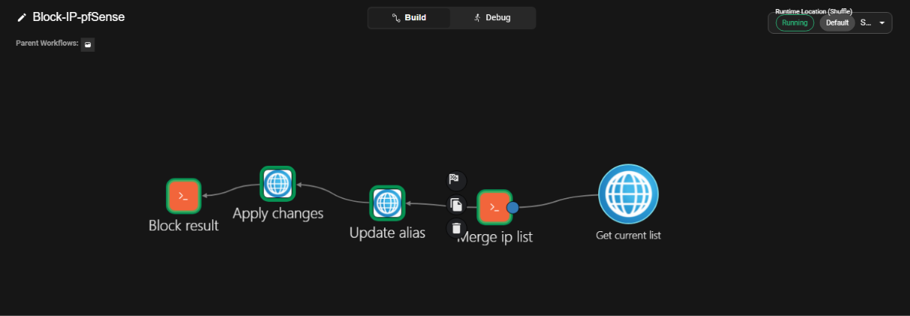
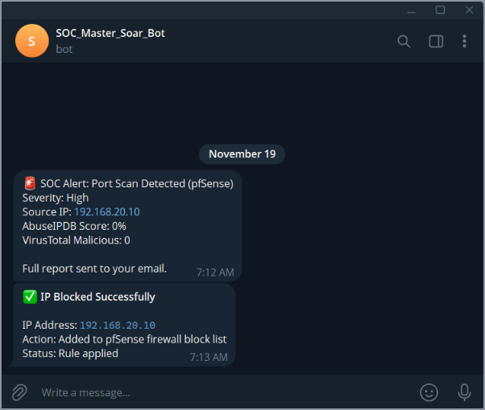
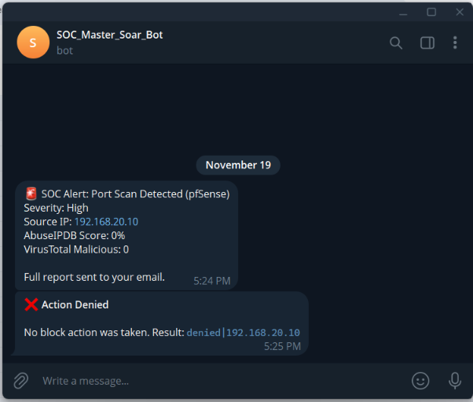
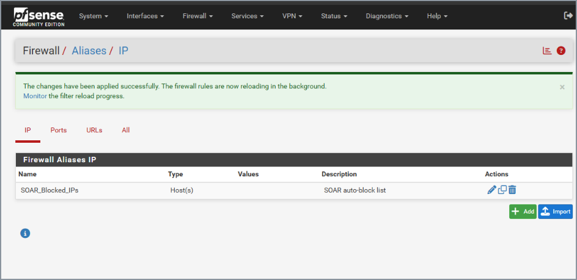
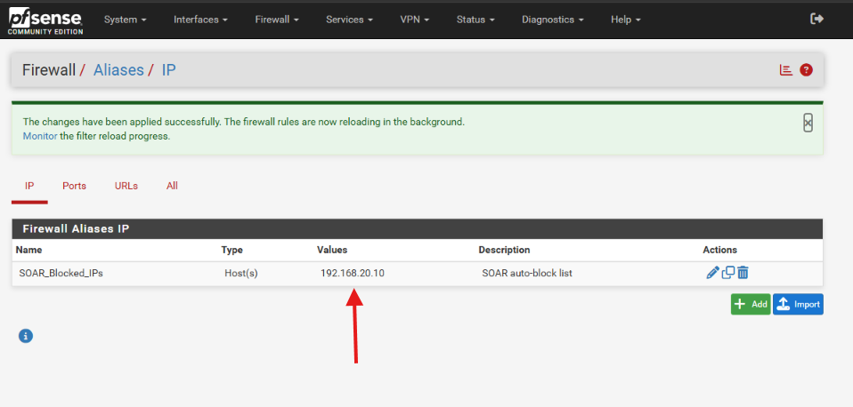
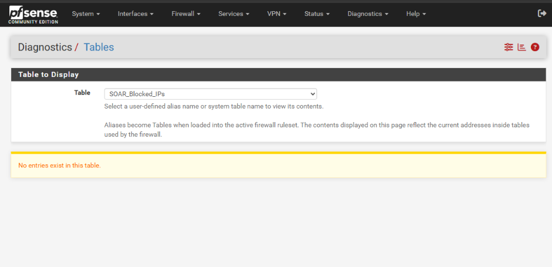
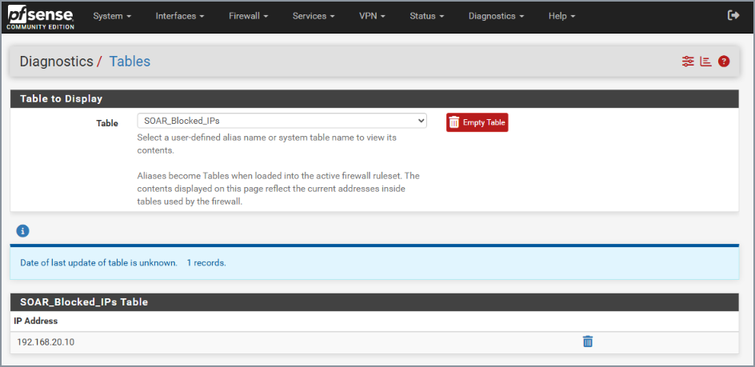

# Block-IP-pfSense



*Get current list → Merge ip list → Update alias → Apply changes → Block result.*

The only workflow in this lab that performs a **real, live remediation action** against infrastructure — adding a malicious IP address to a pfSense firewall alias, which an existing firewall rule already references to block traffic. This is not a simulated or logged-only action; the alias is actually updated via pfSense's API, and the block takes effect immediately.

## Workflow Steps

```
Get current list  →  Merge ip list  →  Update alias  →  Apply changes  →  Block result
```

### 1. Get current list
Retrieves the current contents of a dedicated pfSense firewall alias (e.g., `SOAR_Blocked_IPs`) via the pfSense API — the existing set of IPs already blocked by prior automated or manual action.

### 2. Merge ip list
Appends the new IP (from the triggering alert) to the existing list, rather than overwriting it — ensuring previously-blocked IPs from earlier incidents remain blocked when a new one is added.

### 3. Update alias
Pushes the merged list back to pfSense as the new alias contents via API call.

### 4. Apply changes
A separate, explicit API call — pfSense requires alias/rule changes to be committed with a distinct "apply" action before they take effect on the live firewall ruleset, mirroring the two-step "stage, then commit" pattern of the pfSense web UI itself.

### 5. Block result
Returns a structured success/failure result, which the calling branch reports back to the analyst via Telegram (see the "IP Blocked Successfully" confirmation message in [`Check-Telegram-Approvals`](./05-check-telegram-approvals.md)).

## Why This Is Gated Behind Human Approval

This workflow is **never called directly** by the Master Playbook's enrichment branches. It is only invoked from [`Check-Telegram-Approvals`](./05-check-telegram-approvals.md), and only after an analyst explicitly taps **"Block"** on the Telegram notification for that specific incident. A fully-automated, zero-approval IP block was deliberately rejected as a design choice — an enrichment lookup returning a false positive (a shared corporate NAT gateway misidentified as malicious, for instance) could otherwise cause a legitimate business partner, remote employee, or cloud service to be silently firewalled with no human in the loop. Read-only enrichment (checking reputation, resolving identity) is safe to fully automate; a state-changing action against production infrastructure is not, and this workflow's placement in the overall automation graph reflects that distinction deliberately.

## Validation

Tested against the live Port Scan detection (see [`detections/03-port-scan-pfsense.md`](../detections/03-port-scan-pfsense.md)):

<table>
  <tr>
    <th width="50%">Analyst taps <b>Block</b></th>
    <th width="50%">Analyst taps <b>Ignore</b></th>
  </tr>
  <tr>
    <td align="center"></td>
    <td align="center"></td>
  </tr>
  <tr>
    <td valign="top"><code>✅ IP Blocked Successfully</code> — the attacking IP is added to the pfSense alias, confirmed with the specific action taken.</td>
    <td valign="top"><code>❌ Action Denied</code> — no change is made to the firewall, confirming the approval gate actually <em>prevents</em> the action rather than merely logging a denial after acting anyway.</td>
  </tr>
</table>

Both outcomes were tested against the same alert type on separate occurrences, confirming the branch logic in [`Check-Telegram-Approvals`](./05-check-telegram-approvals.md) correctly diverges based on the analyst's actual choice rather than always defaulting to one path.

### Firewall-Side Verification

The Telegram messages show what the analyst sees; the pfSense UI shows what actually changed on the firewall. The alias `SOAR_Blocked_IPs` was checked in two places — **Firewall → Aliases** (the configured list) and **Diagnostics → Tables** (the contents loaded into the live ruleset) — before and after tapping **Block**.

<table>
  <tr>
    <th width="12%"></th>
    <th width="44%">Before Block</th>
    <th width="44%">After Block</th>
  </tr>
  <tr>
    <td><b>Firewall → Aliases</b></td>
    <td align="center"></td>
    <td align="center"></td>
  </tr>
  <tr>
    <td><b>Diagnostics → Tables</b></td>
    <td align="center"></td>
    <td align="center"></td>
  </tr>
</table>

*Before the action the alias is empty and the table reports "No entries exist in this table"; afterwards `192.168.20.10` appears in both, confirming the change reached the active firewall table and not just the saved configuration.*
