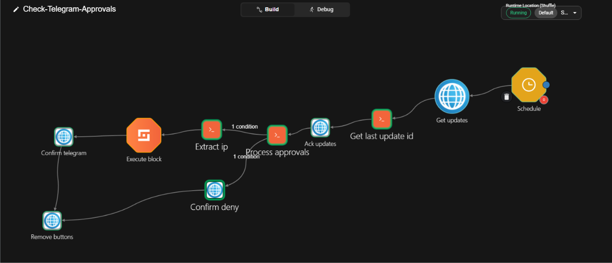
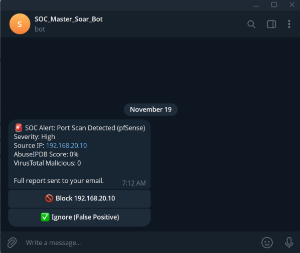

# Check-Telegram-Approvals



*Polls Telegram on a schedule, extracts the IP from whichever button was tapped, and branches into an approve or deny path.*

The human-in-the-loop control that gates [`Block-IP-pfSense`](./04-block-ip-pfsense.md) behind an explicit analyst decision, implemented via a dedicated Telegram bot (`SOC_Master_Soar_Bot`).

## Why Telegram, and Why Polling

Shuffle's self-hosted deployment in this lab has no public-facing webhook endpoint of its own (it sits on the internal lab network, the same reachability constraint discussed in [`cloud-integration/`](../cloud-integration)), so it cannot receive Telegram's native push-based callback webhooks directly. Instead, this workflow **polls** the Telegram Bot API on a schedule, asking "has anyone responded since I last checked?" — a pull-based pattern that works regardless of whether Shuffle itself is reachable from the internet.

## Workflow Steps

```
Schedule → Get updates → Get last update id → Ack updates → Extract ip → Process approvals
    ├─(approve)→ Confirm telegram → Execute block → Remove buttons
    └─(deny)   → Confirm deny → Remove buttons
```

### 1. Schedule
Runs on a short recurring interval, checking for new analyst responses.

### 2–3. Get updates / Get last update id
Calls Telegram's `getUpdates` API and tracks the last-processed update ID, so the same button press isn't processed twice on the next polling cycle.

### 4. Ack updates
Confirms receipt of the processed updates back to Telegram's API (advancing the offset), completing the at-least-once delivery contract of the polling pattern.

### 5. Extract ip
Parses the IP address embedded in the original alert message's callback data, so the correct target is acted on regardless of how much time has passed or how many other alerts have since been sent.

### 6. Process approvals — two-way branch
- **If "Block" was tapped:** routes to `Confirm telegram` → invokes [`Block-IP-pfSense`](./04-block-ip-pfsense.md) → reports the result back to the same Telegram chat
- **If "Ignore (False Positive)" was tapped:** routes to `Confirm deny`, records the decision, and explicitly reports `❌ Action Denied — No block action was taken`, rather than simply doing nothing silently

### 7. Remove buttons
After either path, the inline Block/Ignore buttons are removed from the original Telegram message — preventing an analyst from accidentally tapping a stale decision button on an incident that has already been resolved one way or the other.

## Observed Behavior



*The initial alert as delivered to the analyst — enriched reputation data, a note that the full report was emailed, and two inline action buttons awaiting a decision.*

| Scenario | Telegram Bot Response |
|---|---|
| Analyst taps **Block** | `✅ IP Blocked Successfully — IP Address: <ip> — Action: Added to pfSense firewall block list — Status: Rule applied` |
| Analyst taps **Ignore** | `❌ Action Denied — No block action was taken. Result: denied\|<ip>` |

(See [`Block-IP-pfSense` validation](./04-block-ip-pfsense.md#validation) for both outcomes shown side-by-side.)

## Why This Design Choice Matters

This is the single design decision that most distinguishes this lab's automation from a basic "alert-to-chat" integration. A notification bot that only *informs* an analyst is useful but passive. A fully autonomous bot that blocks on every alert is efficient but risky. This workflow sits deliberately between the two: the system does all the investigative work (enrichment, scoring, formatting) and reduces the analyst's decision to a single tap, but the decision to take an action against production infrastructure always remains a human one — the same principle that governs how real SOAR platforms are configured for any action with potential business impact.
