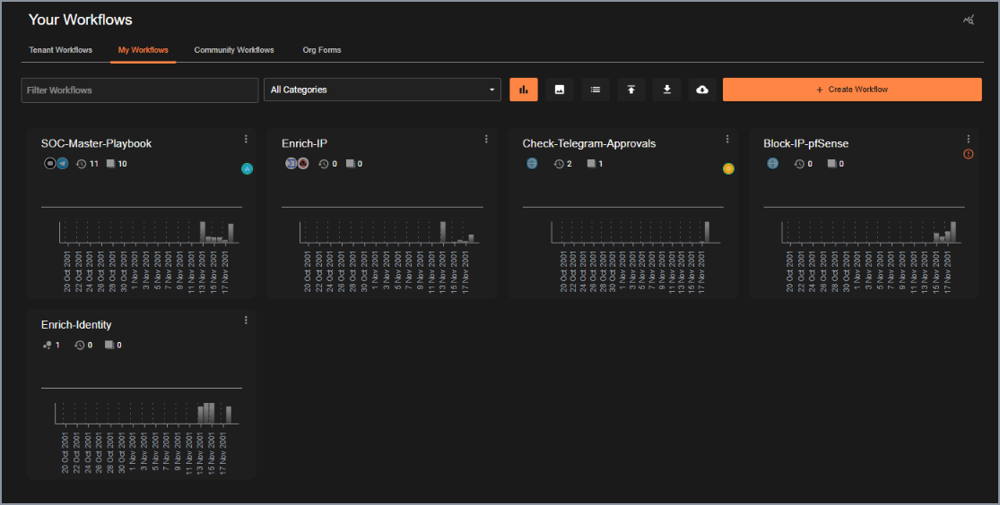

# SOAR Automation

A self-hosted **Shuffle** platform (Docker Compose, deployed on `LAB-SPLUNK1`) closes the loop on every detection in this lab: enriching alert data, notifying an analyst, and — only with explicit human approval — applying a real firewall remediation.

## Why Self-Hosted, Not the Shuffle Cloud Service

Shuffle offers a hosted cloud version (`shuffler.io`) that requires no setup. A self-hosted deployment was chosen instead specifically to demonstrate **running and operating the automation platform itself** — container orchestration, resource planning, and troubleshooting a real deployment — rather than just consuming automation as a SaaS black box. See the deployment notes below for what that actually involved in a resource-constrained lab.

## Why One Router Instead of Ten Independent Playbooks

There are exactly **ten detections** in this lab (see [`detections/`](../detections)) and **ten corresponding enrichment branches** in the automation layer — but this is implemented as **one master playbook with a router**, not ten separate, disconnected workflows. This mirrors how SOAR is actually used in a mature SOC: a single ingestion point receives alerts from the SIEM regardless of type, and routes each one to the correct handling logic based on its content — rather than requiring the SIEM to know about and call ten different webhook URLs, one per alert type. Adding an eleventh detection later means adding one branch to the router, not standing up a parallel, disconnected automation pipeline.

*All five workflows as they appear in the Shuffle dashboard, each with its own run history.*

## Workflow Index

| Workflow | Role |
|---|---|
| [`SOC-Master-Playbook`](./01-soc-master-playbook.md) | Central router — receives every Splunk alert via one webhook, dispatches to the matching enrichment branch |
| [`Enrich-IP`](./02-enrich-ip.md) | Reusable IP-reputation sub-workflow (VirusTotal + AbuseIPDB), called by any branch that has a source IP to check |
| [`Enrich-Identity`](./03-enrich-identity.md) | Reusable identity/role-context sub-workflow for alerts centered on an account rather than an IP |
| [`Block-IP-pfSense`](./04-block-ip-pfsense.md) | Live remediation — adds a malicious IP to a pfSense firewall alias via API |
| [`Check-Telegram-Approvals`](./05-check-telegram-approvals.md) | Polls a Telegram bot for an analyst's approve/deny decision and executes (or withholds) the block accordingly |

## Deployment Notes: Running Shuffle on a Resource-Constrained Host

Shuffle's Docker Compose stack runs five containers (`backend`, `frontend`, `security`, `orborus`, and `opensearch` as the datastore). Deploying it on the same 4 GB VM already running Splunk Enterprise was tested deliberately rather than assumed to be fine or immediately dismissed as impossible:

- Installing Docker and running `docker compose up -d` initially failed with `invalid spec: :/shuffle-apps:z: empty section between colons` — caused by a missing local bind-mount directory (`shuffle-database/`, `shuffle-apps/`) that the compose file expected to already exist. Creating the directories manually resolved it.
- Immediately after all five containers reported `Up`, `free -h` showed **available memory had dropped to ~33 MB**, with the system swapping — a genuinely dangerous level that briefly took the co-located Splunk service down (`ERR_CONNECTION_REFUSED` on port 8000).
- Rather than panicking or immediately provisioning a separate VM, the situation was monitored: `docker stats` showed the actual steady-state memory footprint of all five Shuffle containers combined was only **~80 MB**, and the earlier spike was `opensearch`'s one-time initialization routine, not a sustained requirement. Splunk was restarted, and both services have run stably side-by-side since.

This is documented in detail because it's a realistic, representative example of the kind of capacity-planning judgment call made constantly in real infrastructure work: an alarming resource spike during startup is not automatically the same thing as a sustained resource requirement, and the right response is to measure the steady state before concluding a redesign (separate VM, more RAM) is actually necessary.
