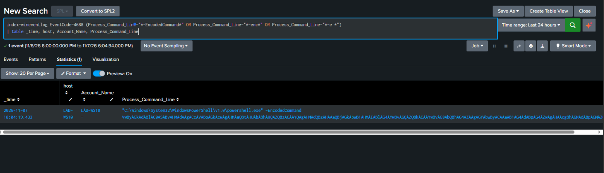

# Hunt 01 — PowerShell Encoded Command

| | |
|---|---|
| **Hypothesis** | An attacker is using `-EncodedCommand` (Base64-encoded PowerShell) to execute commands while evading plain-text review of process command lines |
| **Data Source** | Windows Security Log, Event ID 4688 |
| **Result** | ✅ Positive finding |

## Why This Hunt

`-EncodedCommand` is one of the most common techniques used to obscure malicious PowerShell — the actual command only becomes readable after Base64-decoding, which means a security analyst casually scanning process command lines for suspicious keywords will miss it entirely unless they specifically search for the flag itself. This makes it a good candidate for a *hunt* rather than relying solely on content-based detections.

## Test Activity

To validate the hunt query actually works before trusting a "no results" outcome anywhere else in this lab, a benign Base64-encoded command was deliberately executed on `LAB-WS10`:

```powershell
$cmd = "Write-Host 'This simulates a suspicious encoded command for hunting practice'"
$bytes = [System.Text.Encoding]::Unicode.GetBytes($cmd)
$encoded = [Convert]::ToBase64String($bytes)
powershell.exe -EncodedCommand $encoded
```

## Hunt Query

```spl
index=wineventlog EventCode=4688
(Process_Command_Line="*-EncodedCommand*" OR Process_Command_Line="*-enc*" OR Process_Command_Line="*-e *")
| table _time, host, Account_Name, Process_Command_Line
```

Three flag variants (`-EncodedCommand`, `-enc`, `-e `) are matched because PowerShell accepts any unambiguous prefix of a full parameter name — an attacker (or a legitimate script) may use any of these interchangeably, and a hunt that only matches the fully-spelled-out flag would miss the shortened forms.

## Result



```
2026-11-07 18:04:19  LAB-WS10  LAB-WS10\...  "C:\Windows\System32\WindowsPowerShell\v1.0\powershell.exe" -EncodedCommand VwByaGtAdAB...
```

The test command was correctly surfaced, with the full Base64 payload visible in `Process_Command_Line` — confirming both that the audit policy from [`infrastructure-setup/03`](../infrastructure-setup/03-sysmon-and-audit-policy.md) is capturing command-line content as expected, and that this hunt query reliably catches the technique when it occurs.

## Disposition

Confirmed as expected test activity, not a genuine incident. No further action taken. The query remains documented here as a repeatable hunt to re-run periodically or on-demand during an investigation.
