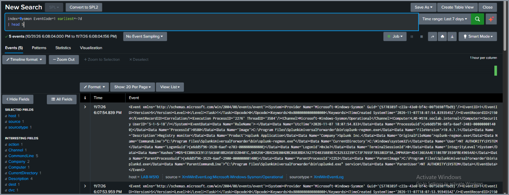
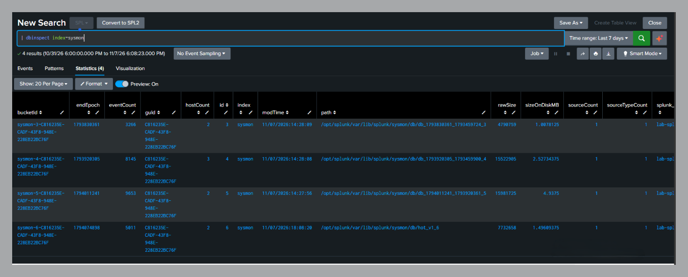

# Hunt 04 — Lateral Movement Indicators (WMI / PsExec)

| | |
|---|---|
| **Hypothesis** | An attacker who has compromised one host is pivoting to others using WMI (`wmic.exe`) or PsExec-style remote execution over an admin share |
| **Data Source** | Sysmon, Event ID 1 (Process Creation) |
| **Result** | ⬜ Negative finding for lateral movement — but the hunt surfaced an unrelated data-integrity issue, which was investigated and resolved as out of scope |

## Why This Hunt

WMI and PsExec are two of the most common legitimate-admin-tool-turned-attacker-technique methods of lateral movement in a Windows domain. Neither requires malware — both are standard remote-administration tooling — which is exactly why they're worth hunting for explicitly rather than relying on a signature-based detection to catch them.

## Hunt Query

```spl
index=sysmon EventCode=1
(Image="*wmic.exe" OR Image="*psexec*" OR CommandLine="*\\\\*\\admin$*")
| table _time, host, User, Image, CommandLine, ParentImage
```

## Result — and an Unexpected Warning

The query returned **0 events**, but surfaced a Splunk system warning alongside the empty result:

```
Failed to read size=57 event(s) from rawdata in bucket='sysmon'~4~{C816235E-CADF-43F8-948E-228EB22BC76F}
path='/opt/splunk/var/lib/splunk/sysmon/db/db_1793920305_1793459900_4'.
Rawdata may be corrupt, see search.log. Results may be incomplete!
```

This is a materially different kind of result than "zero matches" — it means the search *could not fully verify* zero matches, because part of the index it searched was unreadable. Treating this the same as a clean negative finding would have been a mistake, so the hunt paused here to investigate the warning itself before drawing any conclusion about lateral movement.

## Investigating the Data-Integrity Warning

**Step 1 — confirm the index is otherwise readable:**
```spl
index=sysmon EventCode=1 earliest=-7d | head 5
```


Returned normal, well-formed events without error — the corruption is not affecting the entire index.

**Step 2 — scope the damage with `dbinspect`:**
```spl
| dbinspect index=sysmon
```


| Bucket | Event Count | Status |
|---|---|---|
| sysmon-3 | 3,266 | Healthy |
| **sysmon-4** | **8,145** | **Contains the 57 corrupted events** |
| sysmon-5 | 9,653 | Healthy |
| sysmon-6 (hot) | 5,011 | Healthy |

**Step 3 — confirm overall index-wide health:**
```spl
index=* earliest=-7d | stats count by index
```
At the time of this hunt, the full lab was indexing **81,560 total events** across `pfsense` (4,807), `sysmon` (26,089), and `wineventlog` (50,744) — meaning the affected 57 events represented roughly **0.07% of all data in the lab**, isolated to a single bucket.

## Root Cause and Disposition

The corrupted bucket's timestamp range correlates with an earlier incident documented in [`infrastructure-setup/04`](../infrastructure-setup/04-splunk-installation.md): an abrupt VMware shutdown caused by the host disk filling up during unrelated ISO downloads, which forced several VMs (including the Splunk server) to power off uncleanly mid-write.

**Decision: leave the bucket as-is, do not attempt a repair.** The only way to "fix" a corrupted Splunk bucket is to remove it entirely, which would discard all 8,145 events in `sysmon-4` — including the 8,088 healthy ones — to recover from 57 unreadable events. The cost of the fix is far higher than the cost of the problem.

## Conclusion on the Original Hypothesis

With the corruption explained and scoped to an unrelated, pre-existing, and isolated issue, the **0-event result for lateral-movement indicators stands as a valid negative finding** — no evidence of WMI- or PsExec-based pivoting was found in the readable portion of the lab's telemetry.

## Why This Hunt Matters Beyond Its Original Question

This is arguably the most instructive hunt in this folder, not because of what it found about lateral movement, but because of the investigative discipline it demonstrates: a search result came back with a caveat, the caveat was treated as its own mini-investigation rather than ignored or over-reacted to, the actual scope of impact was measured rather than assumed, a root cause was identified by correlating against known lab history, and a documented, reasoned decision was made about remediation — all before returning to answer the original hunting question. This is the same workflow a real SOC analyst follows when a tool or data source behaves unexpectedly mid-investigation.
